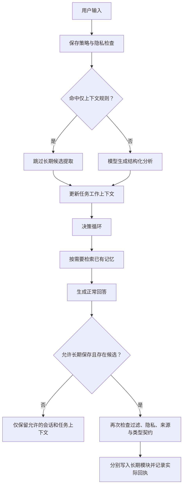

# 四类记忆架构与低价值信息过滤详解

版本日期：2026-10-28。对应代码提交：`d3a1e7e`。本文介绍项目当前实现，不将设计目标或有限测试结果写成已经具备的能力。

## 1. 系统目前怎样理解“记忆”

当前系统把记忆分为四个独立模块：工作记忆、情景记忆、语义记忆、程序记忆。它们分别回答四个问题：

| 模块 | 核心问题 | 生活化例子 | 系统内的用途 |
|---|---|---|---|
| 工作记忆 | 当前任务正在处理什么？ | “这次先给我提纲，暂时不要写正文。” | 保存本任务目标、临时约束、进度和已激活知识 |
| 情景记忆 | 发生过什么？ | “昨天我和同事去公园打了羽毛球。” | 保存有来源的事件、操作及真实结果 |
| 语义记忆 | 知道什么、相信什么？ | “法国的首都是巴黎。”“我喜欢喝乌龙茶。” | 保存事实、偏好、背景知识和文档内容 |
| 程序记忆 | 智能体实际能执行什么？ | 已登记并验证的“合并重复空格”工具 | 保存程序实现引用、契约、版本、启用状态和执行记录 |

这四类首先是**不同的数据结构和处理服务**，不是给所有聊天文本强制贴四选一标签。一个输入可以产生多个不同类型的候选，也可以一个长期候选都不产生。

例如“我平时喝乌龙茶，昨天试了拿铁，这次先帮我比较一下价格”，可以分别形成长期偏好、一次经历和本次任务目标。系统不应为了凑齐四类而重复保存整句话。

### 1.1 需要分清的三个概念

1. **记忆类型**：事实、经历、程序或任务状态。
2. **记录状态**：当前、候选、历史、暂停、启用等生命周期状态。
3. **保存策略**：是否允许长期写入、是否保存会话和工作状态。

三者不能互相替代。记录存进 SQLite，不代表它就成为长期知识；记录价值低，也不代表它自动就是工作记忆。

### 1.2 人类程序性记忆与智能体程序的区别

分类测试里的“我会骑自行车”，可以体现人的程序性记忆。但在本项目真实写入时，它只是关于用户能力的事实，通常应进入语义模块。

系统不能因为用户说“我会骑自行车”，就认为自己已经拥有骑车的执行程序。同样，“先烧水，再放茶叶”是做法文字，不等于已经注册了可调用实现。

只有明确的智能体能力登记请求才应生成程序提议；提议还需要实现、校验与启用，才能实际执行。这也是分类测试成绩不能直接替代实际存储或程序能力验收的原因。

## 2. 总体处理流程



执行层使用固定策略的 LangGraph：`observe → decide → execute → decide`。当前行动主要是检索、回答、学习，最多执行四次，并有重复行动保护。它不是已经具备任意工具规划能力的通用自主代理。

当前通常先生成回答，再处理长期学习。因此，答复中的自然语言不能当成保存凭证。是否真正写入，要看 `memory_results` 中各学习项的实际状态和 `result_refs`。

## 3. 工作记忆：当前任务的运行状态

### 3.1 保存在哪里

主要表为 `working_states`，以 `user_id + thread_id + task_id` 定位一个任务状态。

| 字段 | 含义 |
|---|---|
| `goals` | 当前任务目标 |
| `constraints` | 本任务临时约束，例如“这次用英文” |
| `observations` | 本任务收到的观察及来源引用 |
| `active_knowledge` | 已检索进当前任务的知识引用 |
| `task_state` | 进度、步骤数和停止原因等结构化状态 |
| `open_questions` | 当前尚待确认的问题 |
| `candidate_actions` / `selected_action` | 候选行动和已选行动 |
| `revision` | 状态修订计数 |
| `status` | `active`、`paused` 或 `completed` |

### 3.2 怎样更新

模型可以提出有限的工作状态补丁：`goals`、`constraints`、`open_questions`、`task_state`。系统执行过程还会更新行动状态、激活知识和步骤数。

工作状态按任务恢复；不同任务不应继承彼此的临时约束。聊天切换 `task_id` 时，会清理该会话传给模型的消息历史，以隔离上一任务的要求。

### 3.3 检索进工作记忆，不改变原类型

“我喜欢喝乌龙茶”从语义库检索出来，进入 `active_knowledge` 后仍然是语义知识。工作状态保存的是引用及使用上下文，不是把它重新分类为工作记忆。

引用包含对象 ID、版本、来源、使用目的和原记录，使回答能够追溯到实际记忆。

### 3.4 “短期”不等于“不落盘”

当前会话和工作状态会持久化到 SQLite，方便刷新页面、重启或继续任务。系统尚未实现自动到期清理。

所以“在吗只保留短期上下文”实际表示：允许它留在当前会话和任务状态中，不建立长期知识、长期经历或程序提议。它不表示消息只放在 RAM，也不表示关闭窗口就删除。

## 4. 情景记忆：具体发生的事件

### 4.1 数据组织

`episodes` 是会话／任务的事件容器，`episode_events` 保存具体事件。

关键字段包括：

- `observation`：有原文依据的事件描述。
- `actor`：用户、系统、工具或模型。
- `event_kind`：输入、行动、结果、反馈、纠正或摘要。
- `occurred_at`：实际发生时间；未知时保留空值。
- `recorded_at`：系统记录时间，与发生时间分开。
- `sequence_no`：容器中的事件顺序。
- `outcome`：`unknown`、`partial`、`failed` 或 `succeeded`。
- `source_refs`：来源引用。
- `parent_event_id`、`corrects`：关联或纠正的事件。

### 4.2 写入规则

用户报告的具体经历、真实程序执行结果等，可以进入情景模块。观察分流会检查事件片段是否有原文支持，不能随意概括、补齐经历或猜测结果。

事件采用追加式记录。同一个源事件重试时返回原对象，避免重复记一次；文字相同但实际源事件不同，可以分别保存。纠正通过关联链保留，不需要伪装成从未发生过旧记录。

### 4.3 不能把每次聊天都记成长期事件

虽然数据契约支持 `event_kind=input`，也不意味着每句输入都值得成为长期情景记忆。

“在吗”“我试一下能不能发出去”“1+1等于几”只是当前通信或问答行为。此前测试曾发现模型把后两者作为输入事件保存；现在增加了规则和提示约束，防止这种无差别记录。

### 4.4 检索方式

情景服务支持按用户、范围、任务和结果筛选，再结合词法相关性、时间和顺序排序。当前没有独立向量索引，也没有自动按年龄归档所有情景事件。

## 5. 语义记忆：事实、偏好与知识

### 5.1 断言结构

个人事实和偏好主要保存在 `semantic_assertions`。它不只存一段文字，而是带有关系结构：

```json
{
  "subject": "alice",
  "predicate": "preferred_beverage",
  "value": "乌龙茶",
  "evidence_text": "我喜欢喝乌龙茶",
  "scope": "user",
  "epistemic_status": "explicit",
  "status": "current",
  "source_refs": ["实际来源ID"]
}
```

这是结构示意。真实写入需要事先登记、且属于同一用户的有效来源，不能直接使用示例里的占位 ID。

### 5.2 主要校验与更新规则

| 情况 | 当前处理 |
|---|---|
| 明确事实或稳定偏好，原文证据有效 | 可以保存为当前断言 |
| 同一关系、同一取值和有效时间再次出现 | 合并来源，按证据身份去重 |
| 用户明确纠正自己的单值偏好 | 符合主体、来源等条件时，旧值转历史，新值关联旧版本 |
| 单值关系出现冲突，但不是明确的自身纠正 | 冲突记录标为 `disputed`，不能悄悄认定新值已确认 |
| 原文没有明确陈述，仅为推断 | 保持 `inferred`／候选，不伪装为当前明确事实 |
| 关系允许多个值 | 不因出现另一个值就强制覆盖 |

“以后请用中文回复我”是跨会话偏好；“这次用英文”是临时约束。当前提取提示明确要求区分两者，避免把长期偏好缩写成“本次任务”的要求。

### 5.3 来源与证据

断言必须能在来源正文中找到证据片段。系统允许空白、标点、大小写等规范化差异，并恢复原文；不能接受没有原话依据的凭空断言。

同一出处的重复提取，不应算成多个独立证据。来源有自己的证据身份；是否真正来自独立外部来源，仍依赖调用者提供的身份，系统无法自行证明。

### 5.4 文档知识

`semantic_documents` 保存文档 ID、版本、定位、正文、来源等。文档版本需要可追溯，不应把更新后的正文无声覆盖成原版本。

### 5.5 检索

语义检索会结合范围、主体、关系、有效时间和状态过滤，再进行词法排序。默认检索可返回 `current` 和 `disputed`，并保留状态标签；争议内容不能当作确定事实回答。

历史检查和对象列表用于审查，不等于默认可用的当前知识。模型仍可能误解语义，所以来源校验通过不代表现实世界中的事实一定为真。

## 6. 程序记忆：可验证的智能体能力

### 6.1 三层数据

| 表 | 作用 |
|---|---|
| `procedures` | 程序身份与当前活动版本 |
| `procedure_versions` | 描述、能力类型、实现引用、输入输出契约、实现哈希、验证引用与状态 |
| `procedure_runs` | 某次实际调用的身份、执行状态和结果 |

### 6.2 生命周期


普通流程文本默认没有实现引用，不能直接通过验证和启用。当前执行只允许代码中固定登记的实现，不会根据用户文本动态导入任意代码或调用 `eval`。

### 6.3 当前内置实现

| 实现引用 | 实际用途 |
|---|---|
| `text.normalize` | 合并／整理文本空白 |
| `knowledge.retrieve` | 调用类型化知识检索 |
| `knowledge.learn` | 校验并写入有来源的知识断言 |
| `text.emit` | 生成文本输出 |
| `decision.next` | 根据已完成步骤选择后续行动 |

执行使用 `run_key` 去重。成功、失败等状态按真实结果记录，并可关联情景事件；不能把失败操作写成成功经历。

托管语言模型另外登记 provider/model 等配置，`weights_managed=false`。这是模型配置记录，不表示项目保存或训练了供应商模型权重，也不是能任意执行的本地程序。

因此，总览中的程序对象数量可能包括内置版本和托管模型配置，不等于用户说过多少条技能。

## 7. 来源、事务与实际写入回执

`source_records` 保存来源身份、内容哈希、范围、会话／任务关联和保存策略。`memory_links` 保存支持、派生、冲突、替代、纠正等关系。

实际学习项保存在 `learning_operations`，包括目标模块、状态、结果引用和错误类型。学习项使用 SAVEPOINT 隔离：某一项失败会回滚该项，不应把其他成功项一起伪装为失败，也不能把失败项报告为保存成功。

管理和调用方应以实际回执为准：

- `succeeded` 且有 `result_refs`：对应学习项实际完成。
- `failed`：对应学习项没有确认保存成功。
- `no_new_memory`：没有新的长期写入，不等于聊天失败。
- `disabled`：自动记忆关闭。
- `privacy_blocked`：因隐私或保存限制停止相应写入。

## 8. 低价值信息过滤：为什么需要多层处理

四类概念分类回答“这句话主要表现什么记忆”，低价值过滤回答“它是否值得跨会话保存”。这是两个不同任务。

一条输入可以是有意义的问答，却没有长期记忆价值；也可以很短但很重要。例如“我喜欢茶”应保留为偏好，而“收到”通常只需存在于当前上下文。

当前自动路径没有一个统一的“新架构价值分数阈值”。它采用**保守规则、模型分流、来源校验和写入策略**共同处理。

## 9. 第一层：确定性仅上下文规则

实现位置：[`src/cognitive_memory/value.py`](../src/cognitive_memory/value.py)，函数 `context_only(text)`。

### 9.1 规范化

系统先执行 Unicode NFKC 规范化、去除首尾空白和大小写统一。随后为常用语匹配忽略空白、标点和符号。

例如“有人吗？”可以匹配“有人吗”，“OK”可以匹配“ok”。匹配是针对处理后的整句，不是只要包含某个词就拦截。

### 9.2 当前规则覆盖

| 规则 | 示例 | 处理 |
|---|---|---|
| 纯问候／在线确认 | 在吗、在不在、有人吗、你好、hello | 仅上下文 |
| 纯确认／感谢／附和 | 好的、收到、知道了、谢谢、嗯嗯、哦哦 | 仅上下文 |
| 常见笑声、测试用语 | 哈哈哈、呵呵、测试一下 | 仅上下文 |
| 规范化后没有文字数字 | 纯标点、纯符号、单独表情 | 仅上下文 |
| 同一字符连续重复，长度至少三 | aaaaaa | 仅上下文 |
| 有限的通信探测句式 | 我试一下能不能发出去 | 仅上下文 |
| 明确的测试消息句式 | 这是一条测试消息 | 仅上下文 |
| 有限的纯算术提问句式 | 1+1等于几？ | 仅上下文 |

这些是有限规则，不是覆盖所有闲聊和所有数学问题的语义理解器。完全相同字符重复也可能出现在某些有效编码中；保守过滤只阻止其自动长期保存，仍保留当前上下文供本任务使用。

### 9.3 不使用的粗糙规则

系统不按“少于几个字”过滤，也不因句中出现“你好”“测试”等词就整句丢弃。

“你好，我喜欢 Python”“项目测试通过了”“我试着修好了电风扇”不应因这些局部词语而命中纯问候或通信探测规则。

## 10. 第二层：聊天入口跳过长期候选提取

实现位置：[`src/conversation_agent/graph.py`](../src/conversation_agent/graph.py) 的 `_observe`。

只有开启自动记忆、允许持久化、通过隐私检查且未命中 `context_only`，才调用模型分析长期候选。

规则命中后仍会正常生成回答，例如“在吗”可以回答“在的，有什么可以帮你？”；只是没有必要再调用长期记忆提取，让模型猜测它是否是某种重要个人事实。

这减少的是提取调用，不是免除正常答复所需的模型调用。

## 11. 第三层：模型的结构化分流和提示约束

未命中规则的文本，交给模型生成 `ObservationAnalysis`，字段分为：

```text
working_state_patch   当前任务目标或临时约束
episode_candidates    值得保留的具体经历候选
semantic_candidates   明确事实、稳定偏好等候选
procedure_proposals   智能体能力登记提议
```

当前提示强调：

1. 纯问候、在线确认、感谢、附和、测试噪声不生成长期候选。
2. 普通知识提问和试发消息，不因为发生了一次输入行为就成为长期个人经历。
3. 短句中有明确个人事实或偏好，仍应提取。
4. “以后”“今后”“默认”表达的持续偏好，不应改成仅限本任务的约束。
5. 用户的技能陈述不能直接变成智能体已安装程序。
6. 只提取有原文依据的内容，不补写经历、精确时间或技能实现。

模型仍有可能漏提取、误分类或生成不合适候选，所以不能只依赖提示。

## 12. 第四层：没有长期候选，不在来源表留下正文

当模型未给出语义、情景或程序候选时，聊天观察使用 `no_long_term`。

这样做解决了一个容易遗漏的问题：即使没有建立长期记忆对象，也不应把普通闲聊正文额外完整保存进 `source_records`。

当前处理结果是：

| 位置 | 低价值输入／空长期候选的正文 |
|---|---|
| 会话消息和检查点 | 按会话策略保留 |
| 当前任务工作状态 | 按任务策略保留 |
| `source_records.content` | 不保留正文，可保留来源身份等元信息 |
| `semantic_assertions` | 不新建长期断言 |
| `episode_events` | 不新建长期事件 |
| 有用户来源的 `procedure_versions` | 不新建能力提议 |

学习阶段也会检查候选是否为空。没有候选时直接报告 `no_new_memory`，避免再次以可长期保存的方式登记同一观察。

## 13. 第五层：类型化写入服务再次兜底

实现位置：[`src/cognitive_memory/architecture.py`](../src/cognitive_memory/architecture.py) 的 `observe`。

即使调用方绕过聊天入口，直接向类型化 `observe` 提交了分析结果，只要输入命中 `context_only`，原先的 `persist` 也会被降为 `no_long_term`。

长期学习循环只在允许 `persist` 时执行。因此，外部分析器即使给“在吗”提出了语义候选，类型化观察服务也不会照单写入。

需要注意两个入口边界：

- 这层保证针对 `observe` 路径；手动直接写断言、文档等管理接口有各自契约，不等于都经过自动聊天低价值判断。
- 手动保存、旧演化演示和兼容 `add_memory` 仍走旧写入协议。用户主动点击保存属于明确保存操作，当前没有全局禁止。

因此，不应把当前实现描述为“数据库任何入口都不可能保存低价值文本”。

## 14. 新架构与旧评分机制的关系

兼容写入层仍有价值评分，其核心计算为：

```text
write_score = clamp(
    0.52 × importance
  + 0.30 × confidence
  + profile_bonus
  - noise_penalty
)
```

其中画像相关性奖励最多为 0.18；标签含 `noise`／“噪声”，或置信度低于 0.5 时，噪声惩罚为 0.28。低于配置写入阈值的记录放到旧表的 `state_role=working`。

这与新架构的 `working_states` 是两回事：旧表工作层是记录的保存状态，新工作记忆是按任务组织的运行状态。

新类型化断言和事件没有直接套用这套评分。管理列表对不适用的旧评分显示“不适用”，不会伪造一个分数。当前低价值规则也不等于训练好的通用价值评估模型。

## 15. 保存策略、隐私与删除

| 策略 | 会话／工作上下文 | 长期学习 | 来源正文 |
|---|---|---|---|
| `persist` | 可以保存 | 符合所有规则才写入 | 有需要时保存，仍受低价值和隐私约束 |
| `no_long_term` | 可以保存 | 不执行长期学习 | 不保存 |
| `no_persist` | 本次不创建持久化正文／检查点 | 不执行 | 不保存 |

`auto_remember=false` 表示不自动学习长期记忆，不表示禁止正常会话保存。自然语言“不要记住”也不等于完全不持久化；完全不保存本次会话正文需要明确的 `no_persist` 策略。

即使不持久化，模型为生成回答仍可能收到当前输入。这些策略管理的是本项目保存行为，不能据此声称第三方模型服务没有接收输入。

删除来源会影响其派生记忆，并触发保守的会话／检查点清理；当前实现可能清理该用户全部会话，不能把它当成只删除一行的轻量操作。删除在线记录不等于擦除已有离线备份。

## 16. 新旧记忆如何统一展示与召回

`MemoryCatalog` 是统一读取层，它汇总类型化对象和兼容旧记录，不要求所有旧入口立即改成新协议，也不进行双写。

当前助手和 `/api/architecture/retrieve` 使用统一检索；总览和管理主列表使用统一统计与 `view=all`。默认旧 `/api/memories` 列表和旧 `/api/search` 仍保留兼容行为。

统一层保留的边界包括：

- 迁移隔离副本不重复计数。
- 旧工作记录不恢复为另一个任务的运行状态。
- 旧候选不作为已确认当前事实。
- 迁移的未验证记录在引用中标为未验证／候选。
- 旧程序文字可以作为知识检索，不能变成可执行程序。
- 总览计入工作状态、事件、语义断言／文档、程序版本；来源、事件容器和运行日志不额外算作记忆数量。

当前聊天检索路由仍是有限关键词规则：经历相关词倾向情景模块，能力／工具相关词倾向程序模块，其余倾向语义模块。它尚不是通用意图识别器，也不保证所有相关记忆都被召回。

## 17. 常见输入处理示例

以下是设计口径和当前规则说明，不代表每一种自然语言改写都已完成实测。

| 输入 | 自动路径的预期处理 |
|---|---|
| 在吗 | 正常回答；仅上下文，不生成长期候选 |
| 收到，谢谢 | 可能交由模型判断；无长期候选时只保留上下文 |
| 我试一下能不能发出去 | 通信探测规则；仅上下文 |
| 1+1等于几？ | 纯算术提问规则；正常回答，仅上下文 |
| 你好，我喜欢 Python | 不因“你好”过滤整句；提取稳定偏好 |
| 我喜欢茶 | 短句仍可写入语义记忆 |
| 这次只给提纲 | 当前任务约束，不自动成为长期偏好 |
| 以后请用中文回复我 | 跨会话语言偏好，进入语义候选 |
| 昨天我去看了电影 | 有原文依据的具体经历，进入情景候选 |
| 我会游泳 | 分类可体现人的技能；实际存储为关于用户的语义事实，不安装游泳程序 |
| 请登记一个合并空格的工具，先作为待验证能力 | 形成程序提议，仍需实现校验与启用 |

## 18. 已有测试结果与适用范围

固定测试集共 150 条：四类概念各 30 条，低价值输入 30 条。

| 测试 | 数量 | 本轮正确／通过 |
|---|---:|---:|
| 工作记忆概念分类 | 30 | 30 |
| 情景记忆概念分类 | 30 | 30 |
| 语义记忆概念分类 | 30 | 29 |
| 程序记忆概念分类 | 30 | 30 |
| 低价值输入真实聊天与保存检查 | 30 | 30 |

分类为 **119/120，99.17%**。唯一分歧为“我第一次学游泳是在小学”，参考标签为语义，模型预测为情景。样本和争议标签都保留，没有为提高分数删除该条。

低价值检查使用真实模型答复、真实聊天图和独立内存 SQLite，检查长期对象、会话、工作状态及来源正文。首次有效结果为 28/30，修复后先达到 29/30，再达到 30/30；最终 30 条均没有长期用户记忆写入，也没有在来源表保留正文。

修复复测复用了不受过滤代码影响的 120 条分类预测，只重新调用同一批 30 条低价值聊天；没有按错误答案选择性重跑分类。更早一次检查器存在用户 ID 大小写问题，该轮低价值存储判定已作废并留档。

这些样本为项目作者标注，部分来自此前已看过的测试集；修复后同批复测属于开发回归，不是独立盲测。不能把两种测试合成一个“四类分类准确率”，也不能据此保证所有真实输入都正确过滤。

后端回归共 126 项，125 通过、1 项外部运行时测试跳过。运行服务还通过 HTTP 接口复测通信探测、算术提问和未命中规则的问候，原始响应保留。

相关文件：

- [150 条完整测试样例](../evaluation/memory-150/cases.md)
- [测试方法与修复记录](../evaluation/memory-150/README.md)
- [最终逐条结果](../evaluation/memory-150/results/20261028-095022/report.md)
- [Excel 评测结果](../outputs/memory150-eval/150条记忆评测结果.xlsx)

## 19. 当前限制

1. **无自动过期清理**：工作状态和会话会落盘，尚未实现统一 TTL。
2. **有限低价值规则**：未覆盖的复杂闲聊仍依赖模型；短码、重复字符等也有语境歧义。
3. **管理入口边界**：手动保存及直接类型化管理写入，不等于都受聊天入口过滤规则约束。
4. **提取仍可能出错**：多事实输入可能遗漏，主体、关系和事实状态仍可能被模型误判。
5. **检索能力有限**：当前主要为词法检索和有限模块路由，没有通用向量召回与意图规划。
6. **程序能力有限**：只执行固定实现，不具备任意代码安装、训练或供应商权重管理能力。
7. **用户空间不等于认证**：`user_id` 只是本地命名空间，当前不提供完整登录身份和多租户 ACL。

## 20. 代码与接口定位

| 文件／接口 | 负责内容 |
|---|---|
| [`architecture_models.py`](../src/cognitive_memory/architecture_models.py) | 四类对象、观察和结构化分析契约 |
| [`architecture.py`](../src/cognitive_memory/architecture.py) | 来源、工作状态、事件、断言、程序生命周期和实际学习 |
| [`storage/architecture.py`](../src/cognitive_memory/storage/architecture.py) | 类型化表、迁移、对象仓储 |
| [`catalog.py`](../src/cognitive_memory/catalog.py) | 新旧统一读取、统计、详情和来源展示 |
| [`value.py`](../src/cognitive_memory/value.py) | 仅上下文确定性规则 |
| [`graph.py`](../src/conversation_agent/graph.py) | 自动提取入口、决策循环、回答、学习和会话检查点 |
| [`prompts.py`](../src/conversation_agent/prompts.py) | 长期／临时偏好、经历、技能和低价值提取边界 |
| [`llm.py`](../src/conversation_agent/llm.py) | 模型调用、结构化解析和来源片段校验 |
| [`memory_concepts.py`](../src/conversation_agent/memory_concepts.py) | 四类人类记忆概念分类，独立于真实写入分流 |
| [`test_context_only.py`](../tests/test_context_only.py) | 噪声写入兜底、短事实不误拦、空候选正文保留策略回归 |
| `POST /api/chat` | 正常聊天及自动记忆处理 |
| `POST /api/architecture/observe` | 类型化观察、分流和学习回执 |
| `GET /api/architecture/objects/{module}` | 查询指定对象表 |
| `POST /api/architecture/retrieve` | 组合模块检索与工作知识激活 |
| `GET /api/memories?view=all` | 新旧统一管理列表 |
| `GET /api/overview` | 四类对象与兼容记录的统一概览 |

调试“某句话为什么被保存”时，建议依次检查：原始输入、`context_only` 命中结果、模型分析、实际保存策略、学习回执、来源正文和最终模块对象。不能只看助手说了“记住了”，也不能只看一条分类标签。
