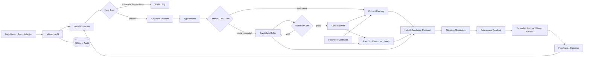
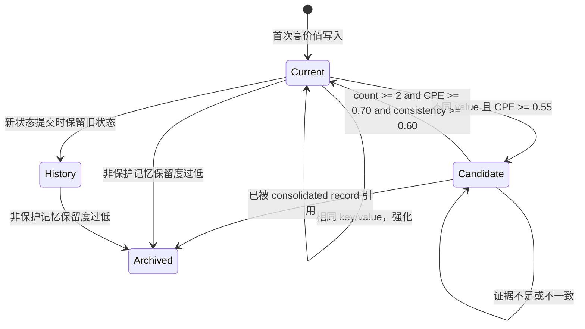

# 认知长期记忆系统产品技术文档 v1.0

> 文档日期：2026-10-17  
> 产品代号：Cognitive Memory Lab  
> 当前阶段：可本地演示的 MVP  
> 运行目录：仓库根目录，使用 `uv run python -m api.app` 启动
> 核心原则：证据先于更新、状态可追溯、能力边界可验证

---

## 1. 文档目的

本文档完成四件事：

1. 重新梳理三篇论文对产品架构的直接启发与适用边界；
2. 给出一个统一、分层、可扩展的长期记忆系统总体架构；
3. 说明本轮已经实现并验证的 MVP，包括数据模型、状态机、API、页面和测试；
4. 区分当前实现、论文机制、未来目标，给出分阶段优化路线。

本文档中的“已实现”只指本地代码与测试可证明的功能。论文报告的指标不自动等于本产品的指标，论文中的完整实验系统也不等于当前 MVP。

---

## 2. 输入资料与审读结论

### 2.1 资料身份校验

| 本地文件 | 主要主题 | 页数 | SHA-256 |
|---|---|---:|---|
| `TAI_template_en(3).pdf` | Melo：认知启发的闭环长期记忆 | 13 | `266C53D75627736AB3CC7EBDEEA33A1205A0E9F1159D7B8F33DABE186684728F` |
| `Main_Manuscript(4).pdf` | AB-Mem：注意力偏置与优先级检索 | 13 | `1B25048932D00BC92FE5499533D80ED5ECE25C29C020BF8C1307A2D0A9974EBE` |
| `Main_Manuscript(3).pdf` | AxoMem：预测误差与证据门控巩固 | 14 | `2EC3229061424B6C4744233E2DA18508BFF3C95F6C415A7C268FB35A92F5CAD6` |

三份文件是三个互补方向，不应只按“版本新旧”理解：

- Melo 解决“整个记忆生命周期怎样闭环”；
- AB-Mem 解决“相关记忆很多时，哪些应获得更高优先级”；
- AxoMem 解决“新信息与稳定记忆冲突时，何时才允许更新”。

### 2.2 三篇论文的产品化分工

| 维度 | Melo | AB-Mem | AxoMem | 本产品取舍 |
|---|---|---|---|---|
| 核心问题 | 写、读、反馈、巩固、遗忘割裂 | 语义相关不等于任务关键 | 单次矛盾可能错误覆盖稳定记忆 | 组合为一个分层闭环 |
| 写入 | 重要度、置信度、画像重合与噪声惩罚 | Saliency、Goal relevance、Persistent preference | 新事件与现有记忆比较 | MVP 实现选择性门和注意力画像 |
| 存储 | Working / Episodic / Semantic / Procedural | 带注意力画像和链接的 Memory Note | Current / History / Candidate | 类型与状态角色分开存储 |
| 更新 | 反馈回流、程序巩固、保留度 | 写入偏置持续影响后续读出 | Candidate 证据累积后才提交 | MVP 实现显式 key/value 冲突状态机 |
| 检索 | 语义候选 + 意图/词法/噪声调整 | 基础相关度 × 偏置 × 动态上下文，支持图传播 | 角色感知读出 | MVP 实现无图版本的乘法调制与角色权重 |
| 遗忘 | 时间衰减与保护标签 | 关注记忆膨胀 | 非重点 | MVP 实现确定性保留度归档 |
| 主要边界 | 不是通用矛盾求解器；隐私与长期部署未证明 | 固定注意力估计与局部图依赖；规模化仍需验证 | 手工误差项与阈值；依赖检索上下文 | 文档明确标注为本地可解释基线 |

### 2.3 关键综合判断

三篇论文最适合形成如下职责链：

```text
Melo lifecycle
  ├─ 写入阶段调用 AB-Mem attention profile
  ├─ 冲突阶段调用 AxoMem evidence gate
  ├─ 读取阶段调用 AB-Mem attention-modulated retrieval
  └─ 反馈阶段回到 Melo update / retention loop
```

不能把三套算法作为互不通信的三个服务，否则会产生重复存储、状态不一致和难以解释的参数耦合。产品应共享同一条 Memory Record、同一套审计事件和同一状态事务。

---

## 3. 产品目标与非目标

### 3.1 本阶段目标

- 在 Windows 本地一条命令启动；
- 不依赖付费 LLM、外部向量库或 Docker；
- 能看到真实的 SQLite 状态变化，不是静态页面原型；
- 演示写入、拒绝、工作记忆、候选、巩固、历史、检索、遗忘、删除和审计；
- 所有核心决策可解释、可测试、可替换；
- 文档能支持后续工程化，而不夸大当前能力。

### 3.2 当前非目标

- 复现三篇论文的完整实验代码与指标；
- 自动理解任意自然语言中的实体、关系、否定和时间范围；
- 训练或微调 embedding、重排器、冲突模型；
- 生产级多租户、登录、RBAC、加密、密钥管理和容灾；
- 支持亿级记忆、分布式索引或跨地域一致性；
- 代替 LLM 完成复杂回答生成。

---

## 4. 总体架构

### 4.1 逻辑架构



### 4.2 部署架构（当前）

```text
Browser
   │ HTTP/JSON, localhost only
   ▼
Uvicorn + FastAPI
   ├── demo/static/index.html
   └── cognitive_memory.Memory
         ├── 编码 / 巩固 / 检索 / 遗忘
         └── storage.SQLiteStorage
               └── memory_product/data/memory_demo.db
```

当前为单进程模块化单体。这样可以保证演示稳定、状态事务简单、安装成本低。核心库采用 `src/cognitive_memory` 布局：HTTP 层调用 `Memory` 统一入口，编码、巩固、检索和遗忘按职责拆分，SQL 集中在 SQLite 存储适配层。写入与审计在同一事务中提交或回滚。

### 4.3 未来生产架构

```text
Agent / Web / SDK
        │
   API Gateway + Auth
        │
 Memory Orchestrator
  ├─ Extraction / Classification service
  ├─ Policy and Consent service
  ├─ Consolidation worker
  ├─ Retrieval and Reranking service
  └─ Audit / Evaluation service
        │
  ┌─────┼─────────────┐
  │     │             │
SQL  Vector Index  Object/Event Store
```

不建议在验证前过早微服务化。先稳定 Memory Record、状态机、事件语义和离线评估，再决定拆分。

---

## 5. 核心领域模型

### 5.1 类型与角色必须正交

类型回答“这条记忆是什么”：

| 类型 | 含义 | 示例 |
|---|---|---|
| Working | 当前会话临时状态 | 尚未完成的中间步骤 |
| Episodic | 带时间和来源的事件 | 某日完成一次任务 |
| Semantic | 稳定事实、偏好、目标 | 用户偏好简洁回答 |
| Procedural | 可复用工作流或策略 | 测试 → 启动 → 健康检查 |

角色回答“这条记忆当前处于什么有效性状态”：

| 角色 | 含义 | 默认读出策略 |
|---|---|---|
| Current | 已确认、当前有效 | 普通查询优先 |
| Candidate | 可能变化但证据不足 | 降权，不能直接覆盖 Current |
| History | 过去曾有效、现已被替代 | 普通查询降权，历史意图升权 |
| Working | 仅当前任务可用 | 长期查询低权重 |
| Archived | 被巩固、遗忘或维护归档 | 默认不参与检索 |

例如，“Python 偏好”可以是 `Semantic + History`，“Rust 偏好”可以是 `Semantic + Current`。如果只存一个 `memory_type` 字段，系统无法同时表达知识形式与时态有效性。

### 5.2 当前 SQLite 记录字段

| 字段 | 用途 |
|---|---|
| `id` | UUID 主键 |
| `user_id` | 本地命名空间；不是生产级身份认证 |
| `content` / `normalized_content` | 原始正文与规范化去重文本 |
| `memory_key` / `memory_value` | 可解释冲突主题与取值 |
| `memory_type` | 四类记忆之一 |
| `state_role` | Current / Candidate / History / Working / Archived |
| `source` | user、user_correction、tool、task_success 等 |
| `tags_json` | 路由、保护、显著性与审计标签 |
| `importance` / `confidence` | 适配器或用户提供的输入元数据 |
| `saliency` / `goal_relevance` / `preference_strength` | AB-Mem 启发的注意力画像 |
| `attention_bias` | 持久注意力偏置 |
| `write_score` | 选择性编码分数 |
| `prediction_error` | 与父 Current 的差异控制信号 |
| `evidence_count` | 强化或候选证据数量 |
| `parent_id` | 指向被比较或被替代状态 |
| `support_ids_json` | 巩固后保留候选证据 ID |
| `is_protected` | 防止仅因时间衰减删除的重要类型 |
| `created_at` / `updated_at` / `last_accessed_at` | 生命周期时间信息 |
| `metadata_json` | 可扩展结构化元数据 |

### 5.3 审计事件

当前事件类型：

- `DROP_PRIVACY`
- `KEEP_SESSION_ONLY`
- `WRITE_CURRENT`
- `REINFORCE`
- `CANDIDATE`
- `CONSOLIDATE`
- `RETRIEVE`
- `RETENTION`
- `USER_DELETE`

审计事件保存决策原因、阈值、证据计数和支持记录 ID。用户物理删除记忆后，审计事件只保留记录 ID，不保留已删除正文。

---

## 6. 写入管线

### 6.1 顺序

```text
validate
  -> normalize
  -> privacy / do-not-store hard gate
  -> exact duplicate detection
  -> type routing
  -> attention profile
  -> selective write score
  -> current-state lookup
  -> prediction-error gate
  -> candidate accumulation
  -> evidence-gated consolidation
  -> audit + transaction commit
```

硬规则必须先于显著性评分。否则一条用户明确要求“不记住”的高重要度信息仍可能被评分模型写入。

### 6.2 隐私门

当前实现两条最小规则：

1. 正文命中“不要记住 / 不要保存 / do not remember”等指令时直接 `DROP`；
2. 标签含 `sensitive`、`private`、`敏感` 或 `隐私` 时，没有 `consent=true` 就直接 `DROP`。

当前规则不是完整 DLP。银行卡、证件、医疗、位置、未成年人信息等自动检测尚未实现。

### 6.3 选择性编码

MVP 采用 Melo 启发的确定性规则：

```text
write_score = clip(
    0.52 * importance
  + 0.30 * confidence
  + profile_bonus
  - noise_penalty,
  0, 1
)
```

- `profile_bonus`：正文与已确认画像的本地相似度，上限 0.18；
- `noise_penalty`：标签为 noise 或置信度低于 0.5 时取 0.28；
- 当前写入阈值：0.42；
- 分数低于阈值时决策为 `KEEP_SESSION_ONLY`，写入 Working，而不是长期 Current。

重要说明：系数来源于论文启发并为了演示采用固定值，不代表已在本产品数据上完成最优校准。

### 6.4 注意力画像

写入时计算：

```text
Saliency          = 0.65 * importance + 0.35 * critical_cue_hit
GoalRelevance     = similarity(content, active_goal) or 0.5
PreferenceStrength= recurrence prior, preference tags can raise lower bound
AttentionBias     = sigmoid(1.2*S + 0.8*G + 0.9*P - 1.2)
```

其中关键提示词包含过敏、禁止、必须、紧急、截止、风险和对应英文词。它只是一组可审计启发式规则。

### 6.5 去重与强化

- 同用户、相同规范化正文、未归档：不重复新增，`evidence_count + 1`；
- 同 `memory_key` 且同 `memory_value`：强化 Current；
- 强化会更新重要度、置信度和注意力偏置的上界。

---

## 7. 冲突、候选与巩固

### 7.1 为什么不立即覆盖

单次矛盾可能是临时状态、表达噪声、上下文例外或错误信息。如果每次 `update` 都覆盖 Current，系统容易发生灾难性更新；如果从不更新，又无法适应真实变化。

### 7.2 MVP 的 CPE

```text
CPE = 0.55 * semantic_discrepancy
    + 0.15 * context_discrepancy
    + 0.30 * keyword_discrepancy
```

`CPE` 在当前产品中是“是否进入证据评估”的控制信号，不是梯度，也不是直接更新幅度。

- `semantic_discrepancy`：旧取值与新取值本地表示的 1 - cosine；
- `context_discrepancy`：有相同显式 key 时为 0；
- `keyword_discrepancy`：标签集合的 1 - Jaccard，并对明确不同取值设置差异下界。

### 7.3 状态转移



### 7.4 巩固事务

当三项门同时通过：

1. 旧 Current 在同一事务中改为 History；
2. 匹配的 Candidate 记录改为 Archived；
3. 新建一个 Current consolidated record；
4. consolidated record 的 `parent_id` 指向旧 Current；
5. `support_ids` 保存全部候选证据；
6. 写入 `CONSOLIDATE` 审计事件。

这样既能查询当前状态，也能追溯旧状态和证据链。

### 7.5 当前冲突能力边界

稳定演示依赖显式 `memory_key` 和 `memory_value`。例如：

```json
{
  "memory_key": "coding_language",
  "memory_value": "Rust"
}
```

系统尚不能可靠地从任意自由文本自动判断：

- “我喜欢 Python”与“项目必须用 Rust”是否真正冲突；
- 偏好、能力、任务约束和临时状态是否属于同一维度；
- 否定、比较、时间范围、条件语句和多实体关系；
- 一次陈述是在修正过去，还是只描述某个例外。

---

## 8. 检索与读出

### 8.1 本地候选表示

为了零依赖运行，当前使用：

- 英文/数字技术词 token；
- 中文汉字 unigram；
- 中文相邻汉字 bigram；
- Counter 向量余弦相似度。

它比简单空格分词更适合中文演示，但不具备 embedding 的同义语义泛化。

### 8.2 注意力调制公式

```text
score = base_relevance
      * (1 + 0.65 * attention_bias)
      * (1 + 0.45 * context_match)
      * role_factor
```

这里保留 AB-Mem 的关键原则：基础相关度是语义门。注意力偏置只能放大已经相关的候选，不能把完全无关的信息凭空推入上下文。

### 8.3 角色权重

普通查询：

| 角色 | 因子 |
|---|---:|
| Current | 1.18 |
| History | 0.62 |
| Candidate | 0.58 |
| Working | 0.45 |

历史意图（如“以前、过去、历史、原来”）：

| 角色 | 因子 |
|---|---:|
| History | 1.25 |
| Current | 1.00 |
| Candidate | 0.55 |
| Working | 0.45 |

### 8.4 证据约束回答

当前没有调用 LLM。页面显示的“回答”规则是：

- 无检索结果：返回“证据不足”；
- 有结果：优先拼接 Top Current 的正文；
- 搜索结果同时显示 base、bias、context、role 和最终 score。

这能验证记忆读出顺序，但不能视为完整自然语言生成模块。

### 8.5 尚未实现的检索能力

- dense embedding 与向量 ANN；
- BM25 + dense hybrid；
- cross-encoder 或 LLM reranker；
- AB-Mem 局部图注意力传播；
- 时间区间、实体关系和多跳图查询；
- token budget 感知的上下文压缩；
- 检索缓存、索引分片和延迟监控。

---

## 9. 保留、遗忘与删除

### 9.1 保留度

```text
retention = write_score * exp(-0.04 * age_days)
```

- 当前阈值：0.30；
- 非保护记录低于阈值时变为 Archived；
- 标签属于 profile、preference、goal、procedure、workflow、safety 或类型为 Procedural 时受保护；
- 保护只阻止自动时间归档，不阻止用户主动删除。

### 9.2 用户删除

`DELETE /api/memories/{id}` 对正文执行 SQLite 物理删除。审计保留 `USER_DELETE` 事件和原记录 ID，但不复制正文。

当前没有跨备份擦除，因为 MVP 没有备份系统。生产化时必须定义主库、索引、缓存、日志、对象存储和备份的完整删除 SLA。

---

## 10. API 设计

### 10.1 接口列表

| 方法 | 路径 | 作用 |
|---|---|---|
| GET | `/api/health` | 健康检查 |
| GET | `/api/config` | 当前阈值配置 |
| GET | `/api/stats?user_id=...` | 状态和类型统计 |
| GET | `/api/memories?user_id=...` | 记忆列表 |
| GET | `/api/audit?user_id=...` | 审计时间线 |
| POST | `/api/memories` | 执行完整写入管线 |
| POST | `/api/search` | 注意力调制检索与证据式回答 |
| POST | `/api/maintenance/retention` | 执行保留度检查 |
| POST | `/api/demo/seed` | 重置指定用户并写入演示事件 |
| DELETE | `/api/memories/{id}?user_id=...` | 物理删除一条记忆 |

### 10.2 写入示例

```json
POST /api/memories
{
  "user_id": "demo-user",
  "content": "用户再次确认未来项目主要使用 Rust。",
  "memory_key": "coding_language",
  "memory_value": "Rust",
  "memory_type": "semantic",
  "source": "user_feedback",
  "tags": ["preference", "conflict"],
  "importance": 0.90,
  "confidence": 0.94,
  "consent": false
}
```

可能的 `decision`：

- `DROP`
- `KEEP_SESSION_ONLY`
- `WRITE_CURRENT`
- `REINFORCED`
- `CANDIDATE`
- `CONSOLIDATED`

### 10.3 检索示例

```json
POST /api/search
{
  "user_id": "demo-user",
  "query": "我现在主要使用什么编程语言？",
  "active_goal": "开始新项目",
  "top_k": 5
}
```

响应中的每条结果都包含 `retrieval.score`、`base_relevance`、`attention_bias`、`context_match` 和 `role_factor`。

---

## 11. Web 演示设计

页面包含：

- 服务状态和用户命名空间；
- 活跃、Current/Candidate、History、审计统计；
- 五阶段闭环架构视图；
- 手动写入表单；
- 一键冲突—巩固演示；
- 状态表与物理删除；
- 注意力检索与分数组成；
- 保留度检查；
- 审计时间线。

界面使用响应式单文件 HTML/CSS/JavaScript，不加载外部 CDN，离线可用。所有动态输出在进入 `innerHTML` 前进行 HTML 转义。

---

## 12. 当前代码结构

```text
src/cognitive_memory/
├── __init__.py
├── memory.py             # Memory 统一入口与写入事务
├── models.py             # 记录与写入结果类型
├── enums.py              # 类型与状态
├── config.py             # MemoryConfig
├── encoding.py           # 隐私门、选择性编码与注意力画像
├── consolidation.py      # 冲突判断、证据门与巩固
├── retention.py          # 保留度与归档
├── retrieval/
│   ├── lexical.py        # 中英文词法表示和相似度
│   └── retriever.py      # 召回、排序与读出
└── storage/
    ├── base.py           # 存储接口
    └── sqlite.py         # SQLite schema、读写、审计与事务
api/app.py                # FastAPI 路由、静态资源与 lifespan 生命周期
api/schemas.py            # Pydantic 请求模型
api/middleware.py         # 请求大小限制与缓存策略
demo/static/index.html    # Web 页面
demo/seed.py              # 演示数据
scripts/start_demo.ps1    # Windows 启动脚本
tests/                    # 核心、HTTP 与存储集成测试
```

原数据库表结构和默认位置 `memory_product/data/memory_demo.db` 保持兼容；该目录仅保留运行数据。

---

## 13. 已实现内容（有代码和测试证据）

### 13.1 核心能力

- [x] SQLite 持久化与 schema 自动初始化；
- [x] 用户命名空间；
- [x] 四类记忆和五种状态角色；
- [x] 不记忆指令硬门；
- [x] 敏感标签需明确同意；
- [x] 选择性编码与 Working 降级；
- [x] 精确去重和证据强化；
- [x] 注意力画像与持久偏置；
- [x] 显式主题冲突检测；
- [x] Candidate 证据缓冲；
- [x] 三条件证据门控巩固；
- [x] Current → History 状态保留；
- [x] 支持证据和 parent 可追溯；
- [x] 中英文离线词法相似度；
- [x] 注意力调制与角色感知检索；
- [x] 历史意图读出；
- [x] 证据不足拒答；
- [x] 时间保留度归档；
- [x] 用户物理删除；
- [x] 全链路审计；
- [x] 可视化 Web 页面；
- [x] 一键演示数据；
- [x] PowerShell 启动脚本。

### 13.2 验证状态

当前自动化测试共 25 项：

- 10 项核心领域测试；
- 12 项 HTTP 与应用生命周期测试（含原有 3 项接口测试）；
- 3 项存储集成测试：重开持久化、巩固失败回滚和用户隔离；
- 覆盖健康接口、HTML 首页、seed → search → stats、400 校验错误；
- 本轮验证中 25 项全部通过。

注意：页面已通过 HTTP 返回与静态结构检查，但当前工具环境没有可用的用户侧浏览器控制工具，因此未形成浏览器截图级视觉回归证据。用户可按第 15 节本地打开页面查看。

---

## 14. 尚未实现内容与能力边界

### 14.1 算法层

- [ ] LLM 自动抽取 memory key/value、实体、关系、时间和否定；
- [ ] learned saliency / learned prediction error；
- [ ] dense embedding、向量库与 ANN；
- [ ] 局部图注意力传播；
- [ ] 多跳与因果关系检索；
- [ ] 任意冲突的 merge/split/verify；
- [ ] 程序记忆从多次成功轨迹自动总结；
- [ ] 个性化过度使用与无关画像抑制模型；
- [ ] 不确定性校准和动态阈值。

### 14.2 工程层

- [ ] 身份认证、RBAC 和真正租户隔离；
- [ ] 静态/传输加密与密钥管理；
- [ ] 数据导出、备份、恢复与跨介质删除；
- [ ] 后台任务、队列与失败重试；
- [ ] schema migration；
- [ ] 并发写冲突和多实例事务；
- [ ] 速率限制、审计签名和防篡改存储；
- [ ] 监控、Tracing、SLO、容量和成本测量；
- [ ] Docker / Linux / 云部署脚本；
- [ ] Agent SDK、MCP 或 OpenAI/其他 LLM 连接器。

### 14.3 评估层

- [ ] 在 CMLM-Assist、CABench、AxoBench、LoCoMo 上跑统一协议；
- [ ] 等预算、等 top-k、等模型、等提示比较；
- [ ] 长期在线用户研究；
- [ ] 隐私攻击、误删除和过度个性化评估；
- [ ] p50/p95/p99 延迟、存储增长和单请求成本；
- [ ] 不同阈值的系统性消融与置信区间。

---

## 15. 启动与演示

### 15.1 启动命令

在仓库根目录执行：

```sh
uv sync --locked
uv run python -m api.app --open
```

Windows 也可以执行：

```powershell
.\scripts\start_demo.ps1 -Open
```

接口文档：`http://127.0.0.1:8765/docs`；OpenAPI：`http://127.0.0.1:8765/openapi.json`。

### 15.2 成功信号

终端应显示：

```text
Web UI: http://127.0.0.1:8765
Health: http://127.0.0.1:8765/api/health
```

### 15.3 三分钟演示脚本

1. 打开 `http://127.0.0.1:8765`；
2. 点击“运行一键演示”；
3. 解释第一条 Python 偏好成为 Current；
4. 解释第一次 Rust 只成为 Candidate，证明系统不会单次覆盖；
5. 解释第二次 Rust 使三条件证据门通过；
6. 在状态表中展示 Python = History、Rust = Current；
7. 检索“我现在主要使用什么编程语言？”；
8. 展示 Rust Current 排名更高以及分数组成；
9. 检索“我以前主要使用什么编程语言？”；
10. 展示 History 的读出权重被历史意图提高；
11. 展示花生过敏记忆的高显著性注意力偏置；
12. 打开审计时间线说明每次决策可追溯。

### 15.4 停止

在运行服务的 PowerShell 窗口按 `Ctrl+C`。

---

## 16. 测试与验收

### 16.1 自动化测试

```powershell
uv run --locked python -m unittest discover -s tests -v
```

### 16.2 核心验收矩阵

| 场景 | 输入 | 预期 |
|---|---|---|
| 首次稳定事实 | 高分、无同 key Current | `WRITE_CURRENT` |
| 完全重复 | 相同规范化正文 | `REINFORCED`，不新增重复行 |
| 低价值噪声 | 低重要度、低置信度、noise | `KEEP_SESSION_ONLY` |
| 不记忆指令 | “不要记住……” | `DROP` |
| 敏感无同意 | sensitive + consent=false | `DROP` |
| 单次矛盾 | 同 key 不同 value | `CANDIDATE`，旧 Current 不变 |
| 重复一致矛盾 | 第二条同新 value | `CONSOLIDATED` |
| 普通检索 | “现在” | Current 优先 |
| 历史检索 | “以前” | History 获得更高角色权重 |
| 旧非保护信息 | 高 age、低 retention | Archived |
| 保护信息 | profile / safety / procedure | 不因时间自动归档 |
| 用户删除 | DELETE 指定 ID | 正文物理删除 |

### 16.3 当前验收结论

- 核心领域逻辑：通过；
- HTTP API：通过；
- 首页静态资源：通过；
- 一键演示端到端：通过；
- SQLite 文件持久化：由运行实现支持，演示数据库在首次正式启动后生成；
- 浏览器视觉回归：当前环境未自动截图，需本地人工确认。

---

## 17. 优化路线图

### P0：从演示升级为可靠原型

目标周期建议：1-2 周。

1. 引入 Pydantic/FastAPI 或等价契约层，生成 OpenAPI；
2. 增加 schema migration 和配置文件；
3. 把 key/value 抽取做成 `Extractor` 接口，先接规则，再接 LLM；
4. 使用 sentence-transformer 或远程 embedding 实现可选 DenseRetriever；
5. 保留当前词法检索作为离线回退；
6. 增加原子并发测试、异常恢复和数据库备份/恢复；
7. 增加导出、按用户清空、撤销最近巩固；
8. 建立 50-100 条人工冲突与非冲突用例集；
9. 记录写入、检索和巩固延迟；
10. 增加浏览器 E2E 和截图回归。

### P1：算法验证版

目标周期建议：3-6 周。

1. 接入统一 embedding 与向量索引；
2. 实现 BM25 + dense + reranker；
3. 引入实体—关系—时间 schema；
4. 实现 Candidate 聚类和语义一致性，不只比较完全相同 value；
5. 实现可学习或可校准的 CPE；
6. 增加时间不确定性和条件性状态；
7. 实现程序记忆的轨迹分组、总结和证据引用；
8. 实现记忆图与局部传播，对应 AB-Mem 的图机制；
9. 对 Profile 过度加权设置校准和反事实测试；
10. 建立统一评估 runner，固定模型、top-k、预算和提示协议。

### P2：生产候选版

目标周期建议：6-12 周，依团队和合规要求调整。

1. OIDC/企业 SSO、RBAC、租户隔离；
2. 字段级加密、KMS、密钥轮换；
3. 事件总线和后台巩固 worker；
4. Postgres + pgvector/Qdrant/Milvus 等可替换存储；
5. Redis 缓存与幂等请求；
6. 用户同意、查看、编辑、导出、删除中心；
7. 跨主库、索引、缓存、日志和备份的删除验证；
8. 完整 Observability：metrics、logs、traces、SLO；
9. 灰度、回滚、数据迁移和灾备演练；
10. 红队与隐私影响评估。

---

## 18. 推荐评估体系

产品不能只看最终问答准确率。建议分六层：

| 层 | 指标示例 |
|---|---|
| 写入 | admission precision/recall、重复率、敏感误写率 |
| 演化 | 错误覆盖率、候选转化率、巩固延迟、历史保留率 |
| 检索 | Recall@k、MRR、NDCG、Current/History 角色准确率 |
| 回答 | F1、事实支持率、拒答准确率、过度个性化率 |
| 系统 | p50/p95 延迟、索引大小、写放大、成本 |
| 用户控制 | 删除完成率、导出完整率、同意可追溯率 |

对比实验必须声明：模型、prompt、候选池、top-k、token budget、硬件、缓存、数据划分和随机种子。不同协议的数字不能直接写成同预算优越性。

---

## 19. 安全、隐私与合规风险

### 19.1 当前已有最小控制

- 本地监听默认 `127.0.0.1`；
- 请求体上限 1 MB；
- 静态路径 resolve 后限制在 static 根目录；
- 不记忆指令优先；
- 敏感标签需明确同意；
- 用户可物理删除正文；
- 输出 HTML 转义；
- 不要求 API Key。

### 19.2 仍需解决

- `user_id` 当前由客户端自由填写，不能当身份认证；
- SQLite 文件当前未加密；
- 审计日志未签名、可由本机文件访问者篡改；
- 自动 PII 检测缺失；
- 用户同意没有版本、用途、过期时间和撤回记录；
- 没有数据保留政策和自动删除 SLA；
- 没有 prompt injection / memory poisoning 防护；
- 高显著性恶意输入可能获得更高权重；
- 当前页面确认框不是强授权流程。

---

## 20. 关键设计决策记录

### ADR-001：先采用模块化单体

原因：MVP 需要低安装成本和状态原子性。当前领域边界清晰，未来可以抽出检索、巩固和审计服务。

### ADR-002：SQLite 而非立即引入向量数据库

原因：本轮首要目标是验证状态机和产品闭环。SQLite 便于检查、测试和演示；检索接口保持可替换。

### ADR-003：类型与角色分开

原因：四类记忆描述内容形式，Current/History/Candidate 描述有效性；混合会导致语义不完整。

### ADR-004：硬规则先于评分

原因：隐私、不记忆指令和明确删除不能被显著性或模型分数覆盖。

### ADR-005：注意力采用乘法调制

原因：保持 base relevance 的语义门，防止高偏置无关记录直接进入上下文。

### ADR-006：显式 key/value 保证冲突演示可靠

原因：在没有 LLM/关系抽取器时，不能把字符串差异误称为可靠语义冲突。显式字段使演示可重复、可审计。

---

## 21. 代码—文档追溯矩阵

| 能力 | 实现位置 | 测试位置 |
|---|---|---|
| 数据表和审计表 | `storage/sqlite.py::SQLiteStorage._create_schema` | 所有核心测试间接覆盖 |
| 隐私门 | `encoding.py::Encoder.privacy_reason` | `test_sensitive_*`、`test_do_not_store_*` |
| 选择性编码 | `encoding.py::Encoder.write_score` | `test_low_value_noise_*` |
| 注意力画像 | `encoding.py::Encoder.attention_profile` | seed/search 集成流程 |
| CPE | `consolidation.py::Consolidator._prediction_error` | `test_single_conflict_*` |
| 巩固事务 | `consolidation.py::Consolidator.apply` | `test_single_conflict_*` |
| 检索 | `search` | current/history 两项测试 |
| 遗忘 | `run_retention` | `test_retention_*` |
| 删除 | `delete_memory` | `test_user_delete_*` |
| HTTP | `api/app.py::create_app` | `test_http_api.py` |
| 页面 | `demo/static/index.html` | HTTP 首页测试 + 人工浏览器检查 |

---

## 22. 最终状态声明

截至 2026-10-17：

- 整体架构：已重新规划并写入本文档；
- 论文方法映射：已完成；
- 可运行本地产品：已实现；
- 写入、冲突、候选、巩固、历史、检索、遗忘、删除、审计：已实现；
- 自动化测试：核心、HTTP 与存储集成共 25 项通过；
- 生产能力：未完成；
- 任意自然语言冲突理解：未完成；
- 完整论文实验复现：未完成；
- 浏览器截图级视觉 QA：待用户本机打开后确认或后续接入浏览器测试工具。

这意味着当前交付可以用于组会、方案评审、产品流程演示和下一阶段工程开发，但不应直接部署为保存真实敏感用户数据的生产系统。
