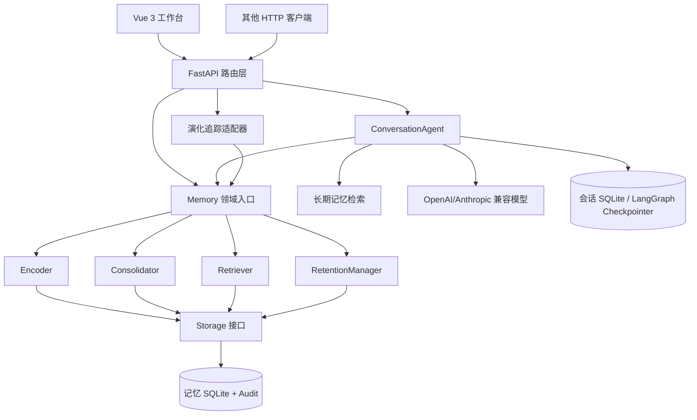
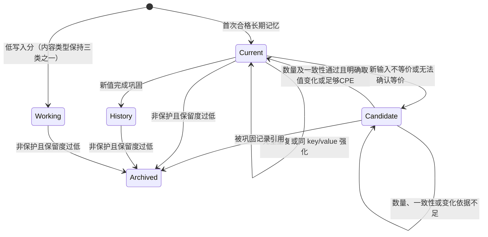

# 认知长期记忆系统产品技术文档 v2.0

> 文档日期：2026-10-19<br>
> 产品名称：Cognitive Science Memory System<br>
> 对应代码基线：`main` / `6c03a49`<br>
> 当前阶段：可本地运行的研究型 MVP<br>
> 默认地址：`http://127.0.0.1:8765`<br>
> 核心原则：证据先于更新、类型与状态分离、决策可解释、边界可验证

> 2026-10-27 更新：在 `e18903f` 合并后本地工作区上，将长期内容类型统一为情景、语义、程序三类，补充旧类型迁移及备份。本页原有架构审计以 2026-10-19 基线为准；本次调整见第 7.1、8 节相关说明。

> 2026-10-27 后续优化：已增加逐条来源表与原始消息跳转、来源事件幂等、相近取值冲突修复、检索状态标记和三个插件的类型参数。第 9 节同步更新巩固规则；其余历史基线描述与当前差异以 [优化实施记录](./优化实施记录_20261027.md) 和 README 为准。

---

## 1. 文档定位

本文档描述当前仓库中已经存在的产品代码，而不是仅描述未来设计。它用于：

1. 解释系统为什么这样设计；
2. 说明每个模块、数据结构、参数和状态转换的实际含义；
3. 给出完整 API、前端、启动、测试与故障排查说明；
4. 区分已实现能力、源码中存在但本轮未运行验证的能力，以及仍未实现的目标；
5. 为三人协作、组会演示、后续开发和技术复盘提供统一依据。

本文件保留架构基线及后续修订。更早的 v1.0 文件当前工作区未保留，本文不依赖该文件才能阅读。

### 1.1 证据口径

本文档按以下优先级判断事实：

1. 当前提交中的源码、配置和测试；
2. 当前 README 与前端说明；
3. v1.0 文档中的论文审读与历史设计记录；
4. 未来路线或论文能力，只能写为“计划”“启发”或“尚未实现”。

### 1.2 验证标签

| 标签 | 含义 |
|---|---|
| 已实现 | 当前源码中存在对应逻辑 |
| 源码有测试 | 当前测试文件中存在对应测试定义 |
| 本轮已运行 | 本次文档更新时实际执行并得到结果 |
| 本轮未运行 | 因环境或依赖未准备，本次只完成静态核验 |
| 尚未实现 | 当前源码中不存在完整实现 |

---

## 2. v2.0 相对 v1.0 的主要变化

| 维度 | v1.0 早期形态 | 当前 v2.0 形态 |
|---|---|---|
| 后端 | Python 标准库 HTTP 服务 | FastAPI + Uvicorn |
| 核心代码 | 单个 `memory_core.py` | `src/cognitive_memory/` 模块化包 |
| 前端 | 原生单页 HTML/CSS/JS | Vue 3 + Vue Router + Vite |
| 页面 | 单页演示工作台 | 总览、助手、记忆管理、记忆演化四页 |
| 对话 | 规则式证据回答 | 可选 LangChain + LangGraph LLM 对话 |
| 会话 | 浏览器本地状态 | SQLite Checkpointer 服务端恢复，浏览器作缓存 |
| API | 手写路由 | Pydantic 校验、OpenAPI、统一错误契约 |
| 演示种子 | 页面直接触发 | 默认关闭，配置令牌后才注册接口 |
| 依赖 | 尽量零依赖 | uv 锁定 Python 依赖，npm 锁定前端依赖 |
| 测试源码 | 13 项早期测试 | 70 个后端测试方法、29 个前端测试调用 |

本次升级不是单纯替换界面，而是重新划分了领域层、存储层、HTTP 层、对话 Agent 和前端状态层。

---

## 3. 研究依据与产品化取舍

### 3.1 三类方法的职责

| 方法来源 | 解决的问题 | 当前产品采用内容 | 未直接照搬内容 |
|---|---|---|---|
| Melo | 长期记忆生命周期割裂 | 四类记忆、选择性写入、反馈/保留思路 | 完整实验系统与论文指标 |
| AB-Mem | 相关不等于重要 | Saliency、Goal relevance、Preference、注意力调制 | 学习式偏置、图传播完整机制 |
| AxoMem | 单次冲突错误覆盖 | Candidate 缓冲、预测误差、证据门控提交 | 任意语义冲突理解与完整实验协议 |

### 3.2 统一产品链路

```text
用户输入
  -> 隐私与不记忆硬门
  -> 选择性编码与注意力画像
  -> 类型路由
  -> 重复/冲突判断
  -> Candidate 证据缓冲
  -> 巩固或继续等待
  -> SQLite 状态与审计事务
  -> 词法召回与注意力排序
  -> API / 对话 Agent / 可视化工作台
  -> 用户反馈和后续新证据
```

三种方法共享同一条 Memory Record、同一套状态角色和同一事务边界，避免形成三套互不一致的记忆库。

### 3.3 参数边界

当前参数是可解释的固定启发式值，用于原型演示和可重复测试。它们没有在真实用户数据上训练或证明最优，不应描述为论文复现结果或生产最优参数。

---

## 4. 产品目标与非目标

### 4.1 当前目标

- 在本地单机环境运行完整记忆闭环；
- 用真实 SQLite 记录展示状态变化；
- 支持写入、拒写、强化、候选、巩固、历史、检索、归档、删除与审计；
- 用 FastAPI 提供明确的 HTTP/OpenAPI 契约；
- 用 Vue 工作台解释系统发生了什么；
- 在配置模型后支持跨会话对话与自动长期记忆；
- 在未配置模型时仍允许使用记忆管理、检索和有限规则演化分析；
- 保持算法、存储和接口边界可替换。

### 4.2 当前非目标

- 生产级身份认证、RBAC 或租户隔离；
- 保存真实敏感用户数据的合规生产部署；
- 任意自然语言关系、否定、条件和时间冲突理解；
- 向量数据库、ANN、图数据库或多跳推理；
- 多进程、多实例或高并发部署；
- 完整复现三篇论文实验指标；
- 证明固定阈值和权重具有统计最优性。

---

## 5. 总体架构

### 5.1 逻辑架构



### 5.2 部署结构

```text
浏览器
  ├─ 生产访问：http://127.0.0.1:8765
  │    └─ FastAPI 同时提供 API 与 frontend/dist
  └─ 前端开发：http://127.0.0.1:5173
       └─ Vite 将 /api、/docs、/openapi.json 代理到 8765

单个 Python 服务进程
  ├─ Memory / SQLiteStorage
  ├─ ConversationAgent / LangGraph
  ├─ 记忆数据库：memory_demo.db
  └─ 会话数据库：memory_demo_sessions.db
```

默认只监听 `127.0.0.1`，没有主动暴露到局域网或公网。

### 5.3 模块职责

| 模块 | 职责 | 不负责 |
|---|---|---|
| `cognitive_memory` | 写入、冲突、检索、保留、审计 | HTTP、页面、模型调用 |
| `storage` | SQLite schema、序列化、事务内数据访问 | 决策策略 |
| `api` | 校验、路由、错误映射、生命周期、静态托管 | 直接编写领域 SQL |
| `conversation_agent` | 检索—回答—记忆工作流、会话检查点 | 绕过 Memory 状态机 |
| `evolution` 路由 | 观察并解释一次真实写入 | 复制另一套记忆算法 |
| `frontend` | 展示、交互、用户空间切换、缓存 | 身份认证或数据最终一致性 |

### 5.4 生命周期和资源所有权

FastAPI lifespan 在服务启动时：

1. 创建或接收 `Memory`；
2. 确定会话数据库路径；
3. 创建 `ConversationAgent`；
4. 在服务停止时关闭 Agent 会话连接；
5. 仅在 Memory 由应用自行创建时关闭它。

测试注入的 Memory 不会被应用错误关闭，这使依赖注入测试能够检查退出后的对象状态。

---

## 6. 当前代码结构

```text
api/
├── app.py                 # FastAPI 工厂、lifespan、异常处理、静态托管
├── dependencies.py        # Memory 依赖注入
├── middleware.py          # 请求大小与缓存策略
├── responses.py           # 统一错误响应
├── schemas.py             # Pydantic 请求模型
├── seed.py                # 可重置演示数据
└── routers/
    ├── system.py          # 健康、总览、配置、统计
    ├── memories.py        # 记忆、审计、保留维护
    ├── retrieval.py       # 检索
    ├── chat.py            # 聊天与会话
    ├── evolution.py       # 自然语言分析与演化追踪
    └── demo.py            # 默认关闭的令牌保护接口

src/cognitive_memory/
├── memory.py              # 统一领域入口、写入事务编排
├── config.py              # 参数配置
├── enums.py               # 记忆类型与状态角色
├── models.py              # MemoryRecord / WriteResult
├── encoding.py            # 隐私门、类型、注意力与写入分
├── consolidation.py       # 重复、冲突、候选与巩固
├── retention.py           # 时间衰减和归档
├── retrieval/
│   ├── lexical.py         # 中英文词法表示
│   └── retriever.py       # 相关度、注意力和角色排序
└── storage/
    ├── base.py            # Storage Protocol
    └── sqlite.py          # SQLite 实现

src/conversation_agent/
├── graph.py               # LangGraph 状态图与会话管理
├── llm.py                 # 模型配置和结构化提取
├── memory.py              # Memory 引擎适配与原文证据检查
├── prompts.py             # 对话与提取约束
└── state.py               # 会话状态及 Pydantic 候选模型

frontend/
├── package.json
├── vite.config.js
└── src/
    ├── App.vue            # 全局布局、导航、用户空间
    ├── router.js          # 四页面路由
    ├── composables/       # 跨页面状态和异步操作
    ├── components/        # 表单、弹窗、图标
    ├── lib/               # API、格式化、总览和演化解释
    ├── views/             # Overview/Assistant/Memories/Evolution
    └── __tests__/         # Vitest 回归测试

scripts/start.ps1          # Windows 启动脚本
tests/                     # Python unittest 测试
pyproject.toml             # Python 项目与依赖声明
uv.lock                    # Python 依赖锁文件
```

旧 `memory_product` 应用源码已移除，但默认数据库仍保存在 `memory_product/data/`，用于兼容原有数据位置。

---

## 7. 核心领域模型

### 7.1 记忆类型：内容是什么

| 类型 | 值 | 含义 | 示例 |
|---|---|---|---|
| 情景记忆 | `episodic` | 带事件属性的经历 | 某日完成一次任务 |
| 语义记忆 | `semantic` | 稳定事实、偏好、目标 | 偏好 Python |
| 程序记忆 | `procedural` | 可复用流程或策略 | 测试—启动—检查流程 |

### 7.2 状态角色：当前是否有效

| 角色 | 值 | 含义 | 默认检索策略 |
|---|---|---|---|
| 工作层 | `working` | 未进入 Current 的持久工作层记录 | 低权重 |
| 当前 | `current` | 当前有效状态 | 普通查询优先 |
| 候选 | `candidate` | 新证据不足以替换 Current | 降权 |
| 历史 | `history` | 曾经有效、已被新状态替换 | 历史意图升权 |
| 归档 | `archived` | 已消费的候选或低保留度记录 | 默认不检索 |

类型与角色必须正交。例如旧的 Python 偏好可以是 `semantic + history`，新的 Rust 偏好可以是 `semantic + current`，低分的语义内容可以是 `semantic + working`。自 2026-10-27 起，类型仅有情景、语义、程序三类；工作层只作为保存状态，完整临时任务工作区尚未另行实现。

旧数据库在打开时自动迁移 `memory_type=working`：按已有标签归入三类，无可识别标签时默认语义记忆；保留 ID、正文、状态、时间及分数，在 metadata 中保留旧类型标记。文件数据库会在迁移前自动生成同目录 `.before-three-types-*.bak` 备份；重复打开不会再次迁移。新 API 和模型提取不接受 working 类型。

### 7.3 MemoryRecord 字段

| 字段 | 类型/作用 |
|---|---|
| `id` | UUID 字符串主键 |
| `user_id` | 规范化后的本地用户空间标识，不是身份凭据 |
| `content` | 原始正文 |
| `normalized_content` | 小写、压缩空白后的去重正文 |
| `memory_key` | 同一主题的稳定键；已知别名先经 `keys.py` 归一化，可为空 |
| `memory_value` | 主题取值；饮品和编程语言等受控主题会先规范取值，可为空 |
| `memory_type` | 情景、语义、程序三类之一 |
| `state_role` | 五种状态之一 |
| `source` | 来源，例如 user、conversation_agent |
| `tags` | 标记列表 |
| `importance` | 输入重要度，范围被截断到 0–1 |
| `confidence` | 输入置信度，范围被截断到 0–1 |
| `saliency` | 显著性 |
| `goal_relevance` | 与活动目标的词法相似度 |
| `preference_strength` | 主题复现和偏好标签形成的强度 |
| `attention_bias` | 持久注意力偏置 |
| `write_score` | 选择性编码写入分 |
| `prediction_error` | 与父 Current 的 CPE |
| `evidence_count` | 重复强化或巩固证据数量 |
| `parent_id` | 被比较或替换的旧 Current ID |
| `support_ids` | 巩固所引用的 Candidate ID |
| `is_protected` | 是否免于时间自动归档 |
| 时间字段 | 创建、更新、最后访问时间 |
| `metadata` | 扩展字典，例如来源 thread_id |

### 7.4 SQLite 表

`memories` 保存正文、类型、状态、分数、证据链与时间；`audit_events` 保存决策事件。主要索引为：

- `(user_id, state_role)`；
- `(user_id, memory_key, state_role)`；
- `(user_id, created_at DESC)` 形式的审计时间访问索引。

SQLite 启用：

- `foreign_keys = ON`；
- `journal_mode = WAL`；
- 进程内 `threading.RLock`；
- `check_same_thread=False`，由上层锁控制并发。

记忆数据库与会话数据库分离。LangGraph Checkpointer 管理其内部检查点表，产品另建 `conversation_threads` 保存用户、公开 thread_id、标题和更新时间。

---

## 8. 写入控制逻辑

### 8.1 实际执行顺序

```text
输入校验
  -> user/content/source/tags 规范化
  -> 不记忆与敏感信息硬门
  -> 完全重复正文检测
  -> 记忆类型推断
  -> 注意力画像
  -> 写入分数
  -> Working 或长期记忆路由
  -> 同 key Current 查询
  -> 同值强化或冲突预测误差
  -> Candidate / Consolidated / Current
  -> 状态和审计同事务提交
```

隐私硬门先于模型分数和冲突处理，显著性不能覆盖用户的拒绝保存意图。

### 8.2 输入默认值

| 字段 | 默认值 |
|---|---:|
| `user_id` | `demo-user` |
| `source` | `user` |
| `importance` | 0.7 |
| `confidence` | 0.8 |
| `consent` | false |
| `memory_type` | 根据标签推断，默认 semantic |

### 8.3 隐私门

当前硬规则：

1. 正文命中“不要记住”“不要保存”“请勿记录”及英文对应短语时，返回 `DROP / do_not_store_instruction`；
2. 标签包含 `sensitive/private/敏感/隐私` 且 `consent=false` 时，返回 `DROP / consent_required`；
3. 拒写时不保存记忆正文，只写 `DROP_PRIVACY` 审计事件。

这不是完整 PII/DLP 系统。电话号码、证件号、地址、医疗信息等没有通用自动检测器。

### 8.4 类型推断

显式合法 `memory_type` 优先；否则：

- procedure/workflow → procedural；
- profile/preference/goal/fact → semantic；
- event/timeline/tool → episodic；
- 其他 → semantic。

### 8.5 注意力画像

```text
saliency = clip(0.65 * importance + 0.35 * critical_cue_hit)

goal_relevance = cosine(content, active_goal)
                 或在没有 active_goal 时取 0.5

preference_strength = 0.5 + 0.15 * min(同 key 记录数, 3)
偏好标签将其下限提高到 0.7

attention_bias = sigmoid(
    1.2 * saliency
  + 0.8 * goal_relevance
  + 0.9 * preference_strength
  - 1.2
)
```

关键提示词包括过敏、禁止、必须、紧急、截止、风险、安全及英文对应词。

### 8.6 选择性编码

```text
write_score = clip(
    0.52 * importance
  + 0.30 * confidence
  + profile_bonus
  - noise_penalty
)
```

- `profile_bonus` 为正文与当前画像内容的词法相似度乘 0.18，上限 0.18；
- 标签为 noise/噪声或 `confidence < 0.5` 时，`noise_penalty = 0.28`；
- `write_threshold = 0.42`。

分数低于阈值时返回 `KEEP_SESSION_ONLY`，记录保留情景、语义、程序三类中的内容类型，并以 `state_role=working` 写入 SQLite。这里的 “SESSION_ONLY” 是兼容保留的决策名称，不代表数据只存在内存；不再支持显式 Working 内容类型。

### 8.7 完全重复与同值强化

- 相同用户、相同 `normalized_content`、未归档：增加已有记录的 `evidence_count`，不新增记录；
- 相同 `memory_key` 和相同非空 `memory_value`：强化 Current；
- 强化时重要度、置信度和注意力偏置取原值与新值的较大者。

在比较前，记忆引擎会对已知模型别名执行确定性归一化。例如 `drink_preference`、`beverage_preference`、`favorite_drink` 均映射到 `preferred_beverage`；“喜欢喝咖啡”和“咖啡”均规范为取值“咖啡”。未知主题键只做保守格式规范，不会被强行合并。

---

## 9. 冲突、Candidate 与巩固

### 9.1 预测误差

```text
CPE = 0.55 * semantic_discrepancy
    + 0.15 * context_discrepancy
    + 0.30 * keyword_discrepancy
```

- `semantic_discrepancy = 1 - cosine(old_value, new_value)`；
- 有相同显式 key 时 `context_discrepancy = 0`，否则为 0.5；
- `keyword_discrepancy = 1 - Jaccard(old_tags, new_tags)`；
- 明确不同的规范化取值会把关键词差异下限提高到 0.75。

### 9.2 默认阈值

| 参数 | 默认值 | 作用 |
|---|---:|---|
| `cpe_low_threshold` | 0.55 | 区分误差型冲突与模糊主题更新；同 key 不等价输入均先缓冲 |
| `cpe_commit_threshold` | 0.70 | 无明确非空取值变化时，巩固要求的误差门 |
| `evidence_consistency_threshold` | 0.60 | 候选间最低一致性 |
| `minimum_evidence_count` | 2 | 最少一致候选数 |

### 9.3 状态机



### 9.4 巩固事务

同 key 的两个非空规范化取值明确不同时，即使 CPE 低于 0.55，也先进入 Candidate。巩固条件为：候选数达到下限、候选一致性达标，且满足「明确非空取值变化」或「CPE 达到提交阈值」。不会人为提高 CPE；Python 3.11 → Python 3.12 等相近字符串也不会新增第二条 Current。历史原话重新出现时作为新的输入与当前记录比较；有稳定消息/事件标识的原事件重放则返回 `UNCHANGED`，不累加证据。

门控通过时，同一事务中：

1. 旧 Current 转 History；
2. 匹配 Candidate 转 Archived；
3. 新建 consolidated Current；
4. `parent_id` 指向旧 Current；
5. `support_ids` 保存所有支持候选；
6. 写入 `CONSOLIDATE` 审计；
7. 任一步异常则整个事务回滚。

### 9.5 冲突能力边界

稳定冲突演示依赖相同的 `memory_key` 和明确的 `memory_value`。当前实现已为饮品偏好和编程语言偏好提供受控别名/取值归一化，但这不是通用语义实体对齐。对于映射表以外的主题，没有模型或调用方结构化信息时，核心引擎仍不会可靠推断：

- 偏好与任务约束是否冲突；
- 条件性、时间性和否定范围；
- 多实体关系；
- 新陈述是纠正、临时例外还是补充。

---

## 10. 检索与证据读出

### 10.1 本地词法表示

当前离线表示由三类 token 构成：

- 英文、数字和常见技术符号词元；
- 中文单字 unigram；
- 相邻中文字符 bigram。

相似度使用 Counter 向量余弦值。它可解释、无模型依赖，但不具备 embedding 的同义词和跨表达语义能力。

### 10.2 检索门与评分

基础相关度低于 `0.025` 的记录先被过滤。剩余候选按下式排序：

```text
score = base_relevance
      * (1 + 0.65 * attention_bias)
      * (1 + 0.45 * context_match)
      * role_factor
```

带 noise/噪声标签的记录最终分数再乘 `0.4`。

### 10.3 角色权重

普通查询：

| 角色 | 因子 |
|---|---:|
| Current | 1.18 |
| History | 0.62 |
| Candidate | 0.58 |
| Working | 0.45 |

命中“之前、过去、历史、以前、原来、history”的查询：

| 角色 | 因子 |
|---|---:|
| History | 1.25 |
| Current | 1.00 |
| Candidate | 0.55 |
| Working | 0.45 |

### 10.4 输出和副作用

- `top_k` 最终限制在 1–20；
- 返回每条记录的基础相关度、注意力偏置、上下文匹配、角色因子和最终分数；
- 命中记录更新 `last_accessed_at`；
- 每次检索写入 `RETRIEVE` 审计；
- 没有结果时返回明确“证据不足”；
- `/api/search` 的 `answer` 是规则拼接，不是 LLM 生成。

---

## 11. 保留、归档与删除

### 11.1 保留度

```text
retention = write_score * exp(-0.04 * age_days)
```

默认归档阈值为 `0.30`。只有非保护记录低于阈值才转 Archived。

### 11.2 保护规则

以下标签或类型自动保护：

- profile、preference、goal；
- procedure、workflow；
- safety；
- Procedural 类型。

保护只阻止自动时间归档，不阻止用户主动删除。

### 11.3 物理删除

`DELETE /api/memories/{memory_id}` 会：

1. 校验该记录属于请求中的 `user_id`；
2. 从 `memories` 表物理删除正文；
3. 写入不含正文的 `USER_DELETE` 审计。

当前没有备份和外部索引，因此尚未定义跨介质删除 SLA。

---

## 12. Conversation Agent

### 12.1 状态图


### 12.2 retrieve

- 使用本轮用户消息作为查询；
- 将历史用户消息拼接为最近关注上下文，最多取末尾 2000 字；
- 从同一 `user_id` 的长期记忆中取最多 5 条；
- 将引用以数据形式注入系统提示，不把记忆正文当作可执行指令。

### 12.3 reply

- 模型最多接收最近 20 条消息；
- 如果切片第一条是孤立 AI 消息，会先移除；
- 系统提示要求优先当前用户明确陈述、避免编造、不能把 Candidate/History 当作当前事实；
- 模型返回空文本或调用异常时，对外只返回受控错误。

### 12.4 remember

回答成功后才执行自动记忆：

1. 检查用户是否要求不要记忆；
2. 最多提取 3 条结构化候选；
3. 每条候选正文必须能映射回本轮用户原文；
4. 去除无证据和重复候选；
5. 敏感候选追加 sensitive 标签但不自动同意；
6. 调用同一个 `Memory.add_memory`；
7. 提取失败保留已生成回答和会话检查点，并返回警告。

Agent 不拥有独立冲突状态机，也不能直接把候选写成 Current。

### 12.5 会话持久化和隔离

- 公开 `user_id + thread_id` 经 UUID5 转换为内部检查点 ID；
- 同一用户、同一 thread_id 可在服务重启后恢复；
- 同一用户不同会话共享长期记忆；
- 不同 user_id 不共享会话和长期记忆查询；
- 会话列表最多返回最近 100 条；
- 删除会话会删除检查点和 `conversation_threads` 行，不删除长期记忆。

这只是命名空间隔离，不是鉴权。客户端仍可自由填写另一个 `user_id`。

### 12.6 LLM 配置

| 变量 | 默认/含义 |
|---|---|
| `LLM_PROVIDER` | `openai`，也支持 `anthropic` |
| `LLM_MODEL` | `gpt-4o-mini` |
| `LLM_API_KEY` | 模型密钥；未设置时聊天不可用 |
| `LLM_BASE_URL` | 可选兼容服务地址 |
| `OPENAI_API_KEY` | OpenAI 兼容别名 |
| `OPENAI_BASE_URL` | Base URL 兼容别名 |
| `CONVERSATION_DB_PATH` | 可选独立会话 SQLite 路径 |

程序先读取项目 `.env`，再由同名 shell 环境变量覆盖。启动时不联网；首次模型调用时惰性创建客户端。模型超时为 45 秒，SDK 最大重试 1 次。

---

## 13. 记忆演化可视化

### 13.1 自然语言入口

`POST /api/evolution/analyze` 只接收：

```json
{
  "user_id": "alice",
  "content": "我现在更喜欢喝咖啡。"
}
```

系统自动执行提取、证据验证、真实写入和过程追踪。

### 13.2 有模型时

- 使用与对话 Agent 相同的结构化提取器；
- 候选必须能恢复为原文连续片段；
- 无原文依据的模型输出被拒绝；
- 模型失败不写入本轮候选。

### 13.3 无模型时

本地规则仅支持完整简单句式：

- 饮品偏好：咖啡、茶、牛奶、水；
- 编程语言偏好：Python、Rust、JavaScript、Java、Go。

默认 `importance=0.7`、`confidence=0.8` 是固定规则值，不是模型评估。

### 13.4 追踪方式

演化路由用代理包装真实 Storage 和 Encoder，观察本次调用产生的：

- 上一条可比较记录；
- 注意力和写入分；
- 本次审计事件；
- CPE、证据数和一致性；
- 最终真实 SQLite 记录。

它不复制核心算法，也不会为了展示完整流程而伪造第二条证据。页面结果是提交时快照，刷新后展示消失，但实际写入保留。

---

## 14. FastAPI 接口

### 14.1 系统接口

| 方法 | 路径 | 说明 |
|---|---|---|
| GET | `/api/health` | 服务健康与版本 |
| GET | `/api/overview?user_id=...` | 用户统计、最近活动、存储和模块状态 |
| GET | `/api/config?user_id=...` | MemoryConfig 参数 |
| GET | `/api/stats?user_id=...` | 类型、角色和审计统计 |

总览中的用户统计是用户范围；数据库文件字节数和 WAL 字节数是整个数据库范围。模型显示“已配置”不等于连接已验证，总览不会主动调用模型。

### 14.2 记忆接口

| 方法 | 路径 | 说明 |
|---|---|---|
| GET | `/api/memories` | 记忆列表；limit 1–1000 |
| POST | `/api/memories` | 完整写入管线 |
| DELETE | `/api/memories/{id}` | 按 user_id 物理删除 |
| GET | `/api/audit` | 最近审计事件 |
| POST | `/api/maintenance/retention` | 执行保留度检查 |
| POST | `/api/search` | 词法召回、注意力排序和规则读出 |

### 14.3 聊天与会话接口

| 方法 | 路径 | 说明 |
|---|---|---|
| GET | `/api/chat/status` | 是否配置模型及模型名，不返回密钥 |
| POST | `/api/chat` | 多轮回答、引用和自动记忆 |
| POST | `/api/sessions` | 新建或确保会话存在 |
| GET | `/api/sessions` | 最近 100 个会话 |
| GET | `/api/sessions/{thread_id}` | 读取单个会话 |
| DELETE | `/api/sessions/{thread_id}` | 删除会话检查点 |

聊天请求：

```json
{
  "user_id": "alice",
  "thread_id": "project-chat",
  "message": "以后请用中文回答，我主要使用 Python。",
  "auto_remember": true
}
```

### 14.4 演化接口

| 方法 | 路径 | 说明 |
|---|---|---|
| POST | `/api/evolution/analyze` | 自然语言自动提取和真实写入 |
| POST | `/api/evolution` | 结构化输入的一次写入追踪 |

### 14.5 演示接口

`POST /api/demo/seed` 默认不注册。只有 `COGNITIVE_MEMORY_DEMO_TOKEN` 非空时才注册，并要求：

```http
Authorization: Bearer <token>
```

它会清空指定演示用户的记忆和审计，再写入固定示例，因此只能用于可重置演示空间。

### 14.6 错误契约

典型格式：

```json
{
  "error": "validation_error",
  "message": "具体原因"
}
```

| 状态码 | 场景 |
|---:|---|
| 400 | JSON/Pydantic/领域校验失败、请求体过大 |
| 401 | 演示令牌缺失或错误 |
| 404 | 记忆、会话或 API 不存在 |
| 502 | 已配置模型但调用或提取失败 |
| 503 | 模型未配置，或前端尚未构建 |
| 500 | 未捕获内部异常 |

### 14.7 请求策略

- `/api/*` 请求体最大 1,000,000 字节；
- 同时检查 Content-Length 和真实流式累计大小；
- API 响应使用 `Cache-Control: no-store`；
- 静态内容使用 `Cache-Control: no-cache`；
- 未知 `/api/*` 路径统一返回 JSON 404。

---

## 15. Vue 工作台

### 15.1 四个页面

| 路由 | 页面 | 核心能力 |
|---|---|---|
| `/#/overview` | 系统总览 | 指标、类型/角色分布、近期变化、模块与存储状态 |
| `/#/assistant` | 个人助手 | 会话恢复、LLM 对话、引用、自动记忆、手动保存 |
| `/#/memories` | 记忆管理 | 筛选、分页、详情、添加、删除、保留度检查 |
| `/#/evolution` | 记忆演化 | 一次输入完整展示提取、编码、比较、巩固和存储 |

旧的 `#overview/#assistant/#memories` 链接会自动转换为带 `/` 的 Vue Router 地址；未知路由回到总览。

### 15.2 全局状态

`createWorkspace()` 管理：

- 当前用户；
- 总览与最多 1000 条记忆；
- 会话列表、当前会话和自动记忆开关；
- 加载、连接、发送、错误、Toast 和确认框；
- 添加记忆表单草稿。

用户切换时递增版本号，旧异步请求返回后会被丢弃，避免把前一个用户的数据写入新用户界面。

### 15.3 浏览器存储

- `cm.user` 保存最近用户空间；
- `cm.chats.<user>` 保存会话缓存和兼容旧版记录；
- 服务端 SQLite 是新会话的持久来源；
- 旧版纯本地会话不会自动上传，继续发送时创建新的服务端会话。

### 15.4 超时

| 操作 | 前端超时 |
|---|---:|
| 普通 API | 20 秒 |
| 聊天 | 300 秒 |
| 演化分析 | 240 秒 |

### 15.5 渲染安全

用户正文通过 Vue 模板文本插值展示；未发现将用户内容直接写入 `v-html` 的设计。固定图标来自本地组件。运行时不依赖外部 CDN。

---

## 16. 配置与依赖管理

### 16.1 Python

- `pyproject.toml` 支持 Python `>=3.10`；
- `.python-version` 指定默认 Python 3.12；
- uv 根据 `uv.lock` 建立 `.venv`；
- `uv sync --locked` 要求锁文件与项目声明一致。

运行依赖：FastAPI、Uvicorn、LangChain OpenAI/Anthropic、LangGraph、SQLite Checkpointer、python-dotenv。开发依赖当前包含 `httpx2`。

### 16.2 前端

- 推荐 Node.js 24；
- 兼容 `^22.12.0 || >=24.0.0`；
- `npm ci` 严格按 `package-lock.json` 安装；
- `npm run build` 输出到 `frontend/dist/`；
- `dist` 与 `node_modules` 不提交 Git。

### 16.3 环境变量优先级

项目 `.env` < shell 同名环境变量。`.env` 已被 Git 忽略，`.env.example` 只包含示例，不应写入真实密钥。

---

## 17. 启动方式

所有命令均在仓库根目录执行：

```powershell
Set-Location -LiteralPath "D:\Agent开发\Cognitive Science Memory System"
```

### 17.1 首次准备

```powershell
uv sync --locked
npm --prefix frontend ci
npm --prefix frontend run build
```

作用：

- 创建锁定的 Python 虚拟环境；
- 安装锁定的前端依赖；
- 生成 FastAPI 可托管的前端产物。

### 17.2 生产式本地启动

```powershell
uv run --locked python -m api.app --open
```

或：

```powershell
.\scripts\start.ps1 -Open
```

自定义端口：

```powershell
.\scripts\start.ps1 -Port 9000 -Open
```

自定义数据库需要使用 Python 入口：

```powershell
uv run --locked python -m api.app --db "D:\path\memory.db" --open
```

### 17.3 前后端开发

后端终端：

```powershell
uv run --locked python -m api.app
```

前端终端：

```powershell
npm --prefix frontend run dev
```

访问 `http://127.0.0.1:5173`。

### 17.4 成功信号

- 终端显示 Uvicorn 正在监听；
- `http://127.0.0.1:8765/api/health` 返回 `status=ok`；
- `http://127.0.0.1:8765/docs` 打开 Swagger；
- 已构建前端时根页面正常加载；
- 未构建前端时根页面返回 503，但 API 和 `/docs` 仍可用。

### 17.5 停止

在后端终端按 `Ctrl+C`。不要直接删除正在使用的数据库或 WAL 文件。

---

## 18. 测试与验证状态

### 18.1 当前源码定义数量

后端共 72 个 `unittest` 测试方法：

| 文件 | 数量 | 主要范围 |
|---|---:|---|
| `test_memory.py` | 11 | 写入、重复、别名归一化、冲突、检索、隐私、保留、删除 |
| `test_http_api.py` | 19 | HTTP、OpenAPI、大小限制、缓存、生命周期、静态资源 |
| `test_conversation_agent.py` | 16 | 会话恢复、隔离、LLM、提取、失败恢复 |
| `test_evolution.py` | 18 | 自动提取、键值归一化、真实追踪、候选、巩固、隐私 |
| `test_overview.py` | 5 | 总览、删除正文保护、模型状态 |
| `test_sqlite.py` | 3 | 重开持久化、事务回滚、用户隔离 |

前端共 29 个 Vitest 测试调用：

| 文件 | 数量 | 主要范围 |
|---|---:|---|
| `workspace.test.js` | 11 | 会话、用户切换、错误恢复、记忆操作 |
| `overview.test.js` | 6 | 统计、模块状态、活动解释 |
| `evolution.test.js` | 6 | 演化页面流程和状态 |
| `evolution-explanations.test.js` | 6 | 指标和变化解释 |

### 18.2 标准测试命令

```powershell
npm --prefix frontend test
npm --prefix frontend run build
uv run --locked python -m unittest discover -s tests -v
```

### 18.3 本轮验证结论

本次文档升级完成了源码、配置、路由、测试定义和 Git 基线的静态核验，但没有运行完整测试。原因是当前机器状态为：

- `uv` 命令未安装；
- 项目 `.venv` 不存在；
- `frontend/node_modules` 不存在；
- `frontend/dist` 不存在；
- 独立 Python 3.12 环境未安装项目依赖。

因此本文件只确认“当前源码定义 70 + 29 项测试”，不把它写成“本轮 70 + 29 项全部通过”。旧 README/v1.0 中的 48+11 是早期快照，不能代表当前测试数量。

如果后续安装依赖，应重新运行上述三条命令，再把结果、日期、环境版本和失败项写入验收记录。

---

## 19. 安全、隐私与可靠性

### 19.1 当前已有控制

- 默认绑定 `127.0.0.1`；
- 1 MB API 请求体上限；
- API 禁止缓存；
- 用户不记忆指令优先于评分；
- 敏感标签需要显式同意；
- 自动提取必须有本轮原文证据；
- 记忆正文物理删除；
- 演示重置接口默认关闭并使用 Bearer 令牌；
- 用户内容通过 Vue 文本插值转义；
- 模型错误不直接回传提供商内部细节；
- 记忆状态和审计同事务提交。

### 19.2 当前风险

- `user_id` 是客户端输入，不是登录身份；
- SQLite 未加密；
- `.env` 密钥依赖本机文件权限；
- 没有通用 PII 检测、用途限制或同意版本管理；
- 审计未签名，可被拥有文件权限的本机用户修改；
- 没有速率限制；
- 没有 CSRF/跨域生产策略；
- 没有数据库备份、恢复和迁移框架；
- 只做进程内串行保护，不支持多实例一致性；
- 记忆投毒和提示注入仅通过提示约束与相关度门有限缓解；
- 模型配置存在不代表真实连接已经验证。

### 19.3 数据边界

当前系统适合本地演示和研究验证，不应直接保存真实身份证件、医疗、财务、密码或其他高敏感信息。

---

## 20. 并发、性能与可运维性

### 20.1 当前并发模型

- Memory 的 SQLite 操作由 `RLock` 串行保护；
- ConversationAgent 同样用 `RLock` 串行会话操作；
- FastAPI 同步路由由框架放入线程池；
- 单进程内可保持事务一致，但吞吐量受串行锁限制；
- 不支持多个服务进程同时依赖进程内锁维护领域顺序。

### 20.2 当前容量特征

- 检索从同用户可检索记录中逐条计算词法相似度；
- 没有倒排索引、向量索引或查询缓存；
- 记忆管理页最多加载 1000 条；
- 会话列表最多 100 条；
- 模型上下文最多最近 20 条消息；
- 适合小规模本地演示，不代表大规模性能。

### 20.3 当前可观测性

已有：

- 领域审计事件；
- HTTP 健康接口；
- SQLite 存储信息；
- 模型错误日志的有限类型信息。

缺少：

- 结构化日志、request ID；
- metrics 与 traces；
- p50/p95/p99；
- 模型 token/成本统计；
- 数据库增长告警；
- SLO 和异常报警。

---

## 21. 决策代码与审计事件

### 21.1 写入决策

| decision | 含义 |
|---|---|
| `DROP` | 隐私硬门拒写正文 |
| `KEEP_SESSION_ONLY` | 写入持久 Working 层，不成为 Current |
| `WRITE_CURRENT` | 首次合格长期记忆成为 Current |
| `REINFORCED` | 强化已有记录，不重复新增 |
| `CANDIDATE` | 冲突证据不足，等待更多证据 |
| `CONSOLIDATED` | 三门通过，新状态成为 Current |

### 21.2 审计事件

| event_type | 触发点 |
|---|---|
| `DROP_PRIVACY` | 隐私或不记忆门拒绝 |
| `KEEP_SESSION_ONLY` | Working 路由 |
| `WRITE_CURRENT` | 新 Current |
| `REINFORCE` | 完全重复或同值强化 |
| `CANDIDATE` | 冲突进入候选区 |
| `CONSOLIDATE` | 完成巩固 |
| `RETRIEVE` | 检索完成 |
| `RETENTION` | 保留度维护完成 |
| `USER_DELETE` | 用户物理删除正文 |

审计按 `created_at DESC, rowid DESC` 排序，避免同一秒多个事件顺序不稳定。

---

## 22. 代码—能力—测试追溯矩阵

| 能力 | 主要实现 | 主要测试 |
|---|---|---|
| 隐私门 | `encoding.py::Encoder.privacy_reason` | `test_memory.py`、`test_evolution.py` |
| 选择性编码 | `encoding.py::Encoder.write_score` | `test_memory.py` |
| 注意力画像 | `encoding.py::Encoder.attention_profile` | Memory/Evolution 测试 |
| 主题键与取值归一化 | `keys.py`、`memory.py::add_memory` | Memory/Evolution 测试 |
| 冲突和 CPE | `consolidation.py::_prediction_error` | Memory/Evolution 测试 |
| 证据门控巩固 | `consolidation.py::apply` | Memory/SQLite/Agent 测试 |
| 事务回滚 | `sqlite.py::transaction` | `test_sqlite.py` |
| 词法检索 | `retrieval/lexical.py` | `test_memory.py` |
| 角色感知排序 | `retrieval/retriever.py` | `test_memory.py` |
| 保留度 | `retention.py` | `test_memory.py` |
| 物理删除 | `memory.py::delete_memory` | Memory/Overview 测试 |
| HTTP 策略 | `api/middleware.py` | `test_http_api.py` |
| 生命周期 | `api/app.py::create_app` | `test_http_api.py` |
| 会话恢复 | `conversation_agent/graph.py` | `test_conversation_agent.py` |
| 原文证据 | `conversation_agent/memory.py::source_span` | Agent/Evolution 测试 |
| 演化追踪 | `api/routers/evolution.py` | `test_evolution.py` |
| 用户切换防竞态 | `useWorkspace.js` | `workspace.test.js` |
| 总览解释 | `overview.js` | `overview.test.js` |

---

## 23. 演示流程

### 23.1 无 LLM 演示

1. 启动服务；
2. 打开“记忆演化”；
3. 输入“我喜欢喝茶。”，观察首次 Current；
4. 输入“我现在更喜欢喝咖啡。”，观察 Candidate；
5. 再用独立输入提供相同新偏好，观察是否满足巩固门；
6. 打开“记忆管理”，检查 Current/History/Candidate/Archived；
7. 在检索 API 或页面中比较“现在”和“以前”；
8. 查看总览最近变化和审计解释。

无模型规则范围有限，复杂输入显示“未识别”是正确边界，不应人工补造结果。

### 23.2 有 LLM 演示

1. 在启动终端配置模型变量；
2. 打开个人助手并创建会话；
3. 发送明确偏好或目标；
4. 查看回答引用和自动记忆结果；
5. 新建另一个会话，验证长期记忆跨会话可用；
6. 删除原会话，确认长期记忆仍保留；
7. 演示“不保存这条信息”和敏感候选拒写。

---

## 24. 常见问题与排查

### 24.1 `uv` 不是命令

原因：尚未安装 uv 或未加入 PATH。安装前应确认目标位置和用户级缓存影响；安装后重新打开终端并执行 `uv --version`。

### 24.2 首页返回 503

原因：`frontend/dist/index.html` 不存在。执行：

```powershell
npm --prefix frontend ci
npm --prefix frontend run build
```

API 与 `/docs` 在此前仍可使用。

### 24.3 聊天返回 503

原因：未配置 `LLM_API_KEY`，或 `.env` 修改后未重启后端。记忆管理和本地检索仍可使用。

### 24.4 聊天返回 502

原因：模型服务连接、限流、兼容性或结构化提取失败。检查 Provider、Model、Base URL 和网络；系统不会把失败候选伪装成已保存。

### 24.5 演示种子接口 404

这是默认安全行为。只有设置 `COGNITIVE_MEMORY_DEMO_TOKEN` 并重启后才注册路由。

### 24.6 修改前端后页面没有变化

生产式运行读取 `frontend/dist`，需要重新执行构建并刷新页面；开发时使用 Vite 5173 获得热更新。

### 24.7 Working 为什么重启后还存在

因为当前 Working 是 SQLite 持久角色。`KEEP_SESSION_ONLY` 表示它没有进入 Current，并不表示只保存在进程内存。

---

## 25. 后续路线图

### P0：可靠原型

1. 安装锁定依赖并重新执行当前 70+29 项测试；
2. 修正 README 中测试数量和页面数量等残留；
3. 增加数据库 schema migration；
4. 增加导出、用户全量删除和备份恢复；
5. 增加 Playwright 浏览器 E2E 与视觉回归；
6. 增加结构化日志、request ID 和基础性能指标；
7. 明确 Working 的产品语义，必要时重命名决策代码；
8. 为配置和阈值建立版本号及变更记录。

### P1：算法验证版

1. 可插拔 embedding 和向量索引；
2. BM25 + dense + reranker；
3. 实体—关系—时间 schema；
4. Candidate 语义聚类，而非只按完全相同 value；
5. CPE 和阈值校准；
6. 图结构与局部传播；
7. 统一 benchmark runner；
8. 反事实、过度个性化和错误覆盖评估。

### P2：生产候选版

1. OIDC/SSO、RBAC 和真实租户隔离；
2. 字段加密、KMS、密钥轮换；
3. Postgres/向量存储与后台队列；
4. 幂等写入和多实例并发控制；
5. 全介质删除验证；
6. 速率限制、审计签名和安全测试；
7. metrics/logs/traces、SLO、告警和容量规划；
8. 灰度、回滚、迁移与灾备演练。

---

## 26. 关键设计决策

### ADR-001：继续采用模块化单体

MVP 更需要事务清晰和低部署成本。当前模块边界已经允许未来拆分，但尚无证据支持立即微服务化。

### ADR-002：SQLite 双库分离

长期记忆与会话检查点生命周期不同，分库可避免删除会话时误删长期记忆，也便于独立切换会话数据。

### ADR-003：类型与状态正交

类型描述知识形态，状态描述当前有效性；两者合并会丢失历史和候选语义。

### ADR-004：硬门优先

用户拒绝保存和敏感同意不能被重要度、注意力或 LLM 判断覆盖。

### ADR-005：注意力只能调制相关候选

先设置基础相关度门，再允许注意力放大，避免高画像偏置把无关信息推入回答。

### ADR-006：Agent 复用同一 Memory 引擎

LLM 只负责回答和候选提取，状态转换仍由核心引擎决定，防止聊天路径形成第二套写入语义。

### ADR-007：演化页面观察真实执行

使用代理捕获本次真实分数和事件，不复制算法、不模拟证据，保证展示与数据库结果一致。

### ADR-008：保留 v1.0，新增 v2.0

架构变化较大，直接覆盖会丢失历史阶段。版本并存可支持比较，README 只指向当前版本。

---

## 27. 当前状态声明

截至 2026-10-19、代码提交 `6c03a49`：

- 模块化认知记忆核心：已实现；
- FastAPI/OpenAPI：已实现；
- Vue 四页面工作台：已实现；
- SQLite 长期记忆、审计与会话检查点：已实现；
- LangChain/LangGraph 多轮对话：已实现，但需要外部模型配置；
- 自动记忆原文证据校验：已实现；
- 自然语言记忆演化页面：已实现；
- 词法检索与固定启发式巩固：已实现；
- 向量检索、图传播和任意冲突理解：尚未实现；
- 生产级鉴权、加密、备份、迁移、监控与多实例：尚未实现；
- 当前源码测试定义：后端 70、前端 29；
- 本次文档更新的完整测试运行：未执行，原因是本机项目依赖环境尚未安装；
- 浏览器截图级视觉验收：本轮未执行。

因此，当前版本可以用于本地学习、组会演示、架构评审和下一阶段开发，但不能直接作为保存真实敏感数据的生产系统。
